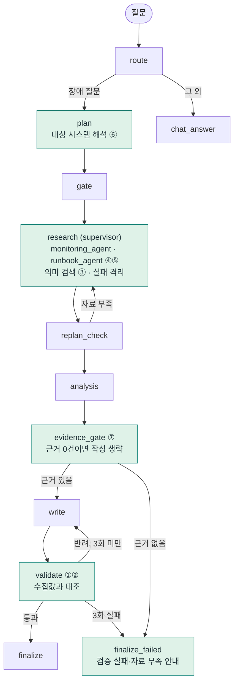

# 운영 장애 진단 에이전트 — 근거 기반 검증·검색·조사 안정성 개선

> AI Capstone 개인과제 · 수업에서 제공받은 **Base AI Agent**(운영 장애 진단: FastAPI + LangGraph + MCP + Vue)를 개선했다.

**한 줄 요약**: 에이전트의 답변을 *수집한 모니터링 자료와 대조*해 틀린 수치를 막고, 매뉴얼을 *의미로 검색*하고, 일부 조사가 실패해도 *확보한 자료로 진행*하며, 그 근거를 화면에서 보여준다.

## 한눈에 보기

| 질문 | 답 |
|---|---|
| 무엇이 문제였나 | 제공받은 에이전트는 답변을 **형식만 검사**(30자 이상 + `1)` 포함)해서 틀린 수치도 통과시켰고, 3회 불합격하면 **강제 합격**시켰다. 매뉴얼은 키워드로 골랐고(못 찾으면 `db-down`), 조사 하나가 실패하면 성공한 자료까지 버렸다 |
| 어떻게 바꿨나 | 답변의 시스템명·CPU·메모리를 수집값과 대조 → 불일치 사유로 재작성 → 끝내 실패하면 **"검증 실패"를 안내**. 임베딩 의미 검색, 작업별 실패 격리, 조사 서브에이전트, 근거가 없으면 작성 생략 |
| 효과는 | 같은 17개 입력에서 틀린 답변 차단 **2/9 → 9/9**(정상 답변 8/8 유지), 매뉴얼 선택 **6/14 → 12/14**, 근거 없는 질문 응답 **36.6초 → 1.2~2.7초** |
| 믿어도 되나 | 수치는 **자체 평가**다. 약점을 겨냥한 사례는 낙관적이고, 실모델은 질문당 1회만 돌렸다. 한계와 스스로 찾은 결함은 아래와 보고서에 그대로 적었다 |

## 이 저장소를 읽는 법

수업 제공 코드와 문서(기본 프로젝트, 매뉴얼, 실행 스크립트, 샘플 데이터)는 **공개할 수 없어 포함하지 않았다.** 그래서 **이 저장소만으로는 에이전트가 실행되지 않는다.** 직접 만든 모듈, 평가·테스트와 그 결과, 설계 기록, 보고서·발표 자료만 담았다.

1. [`submission/결과보고서.md`](submission/결과보고서.md) — 전체 내용과 평가 결과, 한계 (가장 먼저)
2. [`submission/AI_Capstone_발표.pdf`](submission/AI_Capstone_발표.pdf) — 발표 자료 9장
3. [`doc/ADR.md`](doc/ADR.md) — 설계 결정 15개(제공받은 구조의 결정과 직접 변경을 구분)
4. 코드: [`agent/verifier.py`](agent/verifier.py) → [`agent/targets.py`](agent/targets.py) → [`agent/subagents.py`](agent/subagents.py) → [`agent/nodes/evidence_gate.py`](agent/nodes/evidence_gate.py) → [`agent/retrieval.py`](agent/retrieval.py)
5. 평가: [`eval/`](eval/) — 테스트 6종, 평가·측정 스크립트, 실행 결과 원본

## 화면으로 보는 개선 전·후

같은 질문과 같은 틀린 답변(모의 모델이 CPU를 15%p 높게 씀)에서 **검증 설정만** 바꿨다. 모의 모델로 재현한 것이며 실모델 결과가 아니다.

| 개선 전 (형식만 검사) | 개선 후 (수집값과 대조) |
|---|---|
|  |  |
| 수집값과 다른 CPU 100.5%, 54.8%가 근거 표시 없이 **그대로 최종 응답**이 된다 | 3회 재작성해도 일치하지 않아 **답변을 제공하지 않고**, 불일치 사유·수집된 실제 값·근거 비교표를 보여준다 |

정상 진단 화면(근거 비교표 · 매뉴얼 검색 후보와 점수 · 검증 범위): [`submission/최종실행화면_신규.png`](submission/최종실행화면_신규.png)

## 기본 기능 vs 개선 사항

**기본 기능(제공받은 것)**: LangGraph 흐름, MCP 서버(모니터링 도구·매뉴얼·프롬프트), FastAPI·SSE·SQLite 세션, Vue 화면, 병렬 조사와 재시도, fast/quality 모델 분리, LangSmith 추적 코드.

| # | 기본 기능의 문제 | 개선 (직접 변경) | 효과 | 코드 위치 |
|---|---|---|---|---|
| ① | 형식만 검사해서 **틀린 수치도 통과**, 3회 실패는 강제 합격 | 시스템명·CPU·메모리를 수집값과 대조, 불일치 사유로 재작성, 실패하면 "검증 실패" 안내 | 오류 차단 2/9 → 9/9 | `agent/verifier.py` |
| ② | 검증기가 표현에 약함 | 동의어·숫자 먼저·표·'각각'·영어 서술 지원, 임계치·조건문·부정 수치 제외 | 표적 28개: 오류 차단 6/14 → 14/14, 정상 7/14 → 14/14 (자체 사례) | `agent/verifier.py` |
| ③ | 키워드로 매뉴얼 선택 | 로컬 임베딩 **의미 검색**, 점수가 낮거나 차이가 작으면 미확정 | 기대 일치 6/14 → 12/14 | `agent/retrieval.py` |
| ④ | 조사 하나가 실패하면 성공한 자료까지 버림 | 작업별 실패 격리, 시간 제한, 실패 대상 표시 | 부분 자료로 진행 + 한계 표시 | `agent/subagents.py` 외 |
| ⑤ | research 한 함수가 모든 조사를 처리 | monitoring/runbook **서브에이전트**로 분리, research는 supervisor | 구조 정리(성능 이득 없음) | `agent/subagents.py` |
| ⑥ | 없는 시스템을 **몰래 auth-service로 바꿔 조사** | 바꾸지 않고 조사 실패로 안내, 이름이 없을 때만 기본값을 쓰되 알림 | 묻지 않은 시스템 답변 방지 | `agent/targets.py` |
| ⑦ | 근거가 없어도 비싼 작성 모델 호출 | 모니터링 근거 0건이면 작성 생략 → "자료 부족" | 36.6초 → 1.2~2.7초, 호출 1 → 0회 (단일 질문) | `agent/nodes/evidence_gate.py` |
| ⑧ | 한 파일(425줄)에 모든 노드 | `state.py` + `nodes/` 6개 모듈로 분리 | 구조 정리(동작 변경 없음) | (원본 파일과 섞여 미포함) |
| ⑨ | 반려될 초안이 화면에 남고 근거가 안 보임 | 초안 차단, 근거 비교표·검색 후보·검증 범위 표시 | 화면에서 근거 확인 | `submission/` 캡처 |

"외"·"미포함"은 해당 코드가 수업 제공 파일 안에 섞여 있어 이 저장소에 없다는 뜻이다. 변경 내용은 보고서와 ADR에 설명했다.

**측정만 한 것(직접 구현이 아님)**: 병렬 vs 직렬 조사 약 3배(원본의 0.35초/태스크 시뮬레이션 지연 포함), fast/quality 모델 분리 약 59% 절감 추정(글자수 기반·가정 단가), 임베딩 도입의 대가(웜 검색 약 29ms, 콜드 약 1.1초, 모델 639MB).

## 처리 흐름과 바꾼 곳



초록색이 개선한 노드다. 강제 합격 경로는 없어졌고, 재작성은 최대 3회, 재조사는 1회로 제한해 무한 반복을 막았다.

## 검증이 하는 일 (예)

수집값이 `auth-service CPU 81.7%`인데 답변이 `96.7%`라고 쓰면, 작성 단계로 이런 피드백이 돌아간다.

```
auth-service의 CPU 사용률은 수집값 81.7%인데 답변에는 96.7%로 적혀 있습니다. 수집된 값을 그대로 인용하세요.
```

세 번 연속 맞추지 못하면 초안은 버리고 실패 사유와 수집값만 안내한다. 검증하는 것은 **시스템명·CPU·메모리 수치의 일치**뿐이며, 원인 설명의 사실 여부는 판정하지 않는다.

## 결과 (자세한 표와 한계: [`submission/결과보고서.md`](submission/결과보고서.md))

| 항목 | 결과 | 주의 |
|---|---|---|
| 틀린 답변 차단 (같은 17개 입력) | 2/9 → 9/9, 정상 통과 8/8 유지 | 자체 평가셋 |
| 검증 규칙 개선 (표적 28개) | 정상 7/14 → 14/14, 오류 6/14 → 14/14 | **약점을 겨냥한 자체 사례라 낙관적** |
| 매뉴얼 선택 (14개) | 6/14 → 12/14, 무관 질문 미선택 0/2 → 2/2 | 자체 14개, 유사도 점수는 확률 아님 |
| Ollama 실모델 (4문항×1회) | 작성 시도 1.0 → 1.0회, 시간 42.6초 ↔ 43.3초 | **재작성·시간 개선을 주장하지 않음** |
| 근거 없는 질문 응답 | 36.6초 → 1.2~2.7초, 작성 호출 1 → 0회 | 단일 질문, 근거 0건일 때만 |

**평가 방식**: 규칙을 고치기 **전에** 사례를 먼저 쓰고 개선 직전 검증기를 `eval/baseline/`에 스냅샷으로 보관해 같은 사례로 비교했다. 사례는 세 묶음이다 — 표적 회귀 28개(지목한 약점), 설계 시 보지 않은 변형 6개, 개선 직후 자체 점검에서 찾은 부작용 탐침 8개.

## 솔직한 메모 — 스스로 찾은 문제

- 임계치·조건문을 제외하는 규칙이 처음에 "CPU가 99% 이상 지속"처럼 **틀린 측정값을 통과시켰다.** 평가를 다시 돌려 찾아 고쳤고, 그 수정이 실제 런북 문장을 놓치는 회귀를 만들어 한 번 더 고쳤다.
- 실모델에서 재작성이 줄었다고 정확해진 게 아니다. 시스템명 요구를 완화한 영향이고, 개선 전(legacy)도 처음부터 1.0회였다. 시간은 같은 설정에서도 실행마다 두 배 넘게 달랐다.
- 비용 절감 추정이 47%에서 59%로 바뀐 것은 검증 오탐으로 인한 불필요한 재작성이 사라진 효과였다.
- 외부 검토에서 **미조회 시스템의 수치가 다른 시스템과 같으면 통과**하는 버그와 **비슷한 이름(oauth-service/auth-service)이 섞이는** 버그가 발견돼 고쳤다.

## 한계

- 검증은 수치의 일치만 본다. 규칙 기반이라 새 표현을 놓칠 수 있다.
- 수치-시스템 연결은 "직전에 나온 시스템명" 규칙이라, 미조회 시스템 설명 뒤에 다른 시스템의 수치가 오면 정직한 서술도 반려할 수 있다. 시스템 이름 꼴 규칙은 `customer-service`·`top-10` 같은 일반 표현을 시스템으로 오인한다.
- 평가는 소규모 자체 데이터이고 실모델은 질문당 한 번씩만 돌렸다. OpenAI 실모델과 LangSmith 기반 비교 평가는 하지 않았다(추적 기록 확인만 했다).
- 서브에이전트는 LLM 판단 없이 도구를 호출하는 작업자이며 성능 이득은 없다.
- 초안 비공개를 위해 토큰 단위 스트리밍을 포기했고, 시스템명 요구를 완화한 대가로 수치 없는 답변은 대조 없이 통과한다.

## 파일 구성

```
agent/
  verifier.py            근거 대조 검증기
  targets.py             대상 시스템 해석 (known / unknown / defaulted)
  subagents.py           monitoring_agent · runbook_agent (LangGraph 서브그래프)
  retrieval.py           임베딩 의미 검색
  nodes/evidence_gate.py 근거 0건이면 작성 생략
eval/                    테스트 6종 · 평가 · 측정 스크립트 · 실행 결과(JSON/MD) · baseline/
doc/                     ADR(설계 결정 15개) · 체크리스트 · 검증 설명 · LangSmith 확인 절차
submission/              결과보고서 · 발표 PPT/PDF · 대본 · 화면 캡처
```

테스트·평가 스크립트는 수업 제공 기본 프로젝트(그래프·MCP 서버·샘플 데이터)가 같은 위치에 있어야 실행된다. 결과 파일(`eval/*-20261021.*`, `eval/results.md`)은 실행 결과 그대로 올려 두었으니 읽는 방법은 보고서 5절을 본다.
