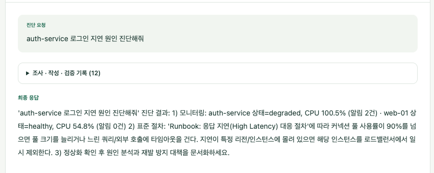
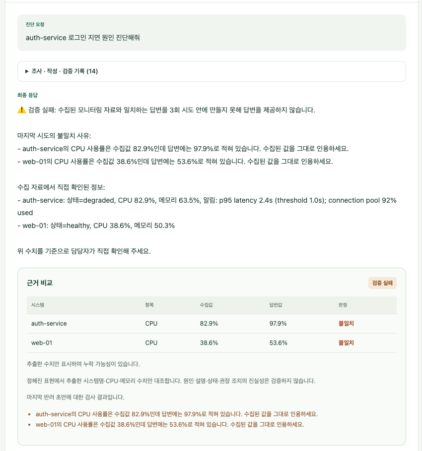
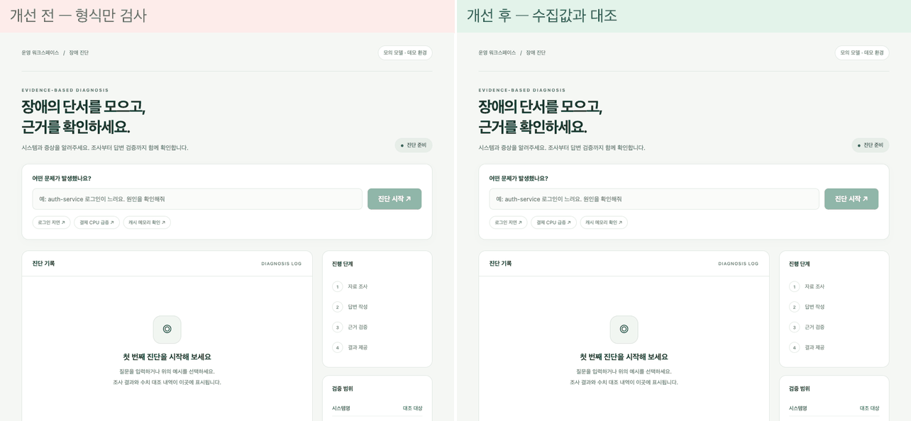
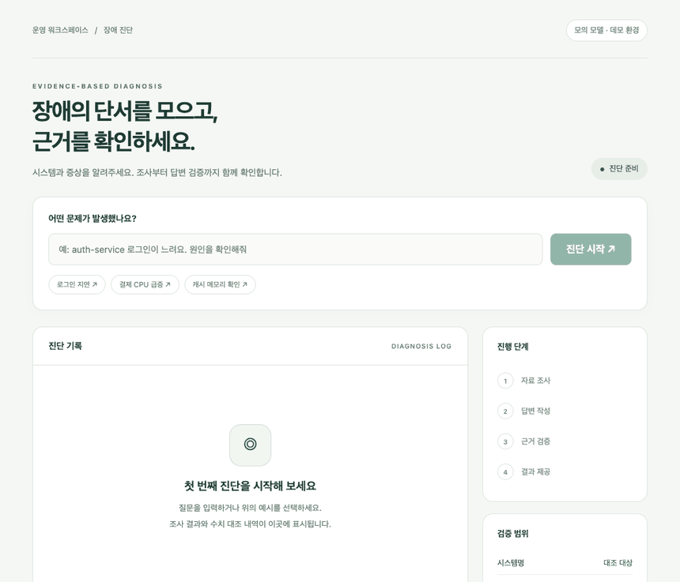
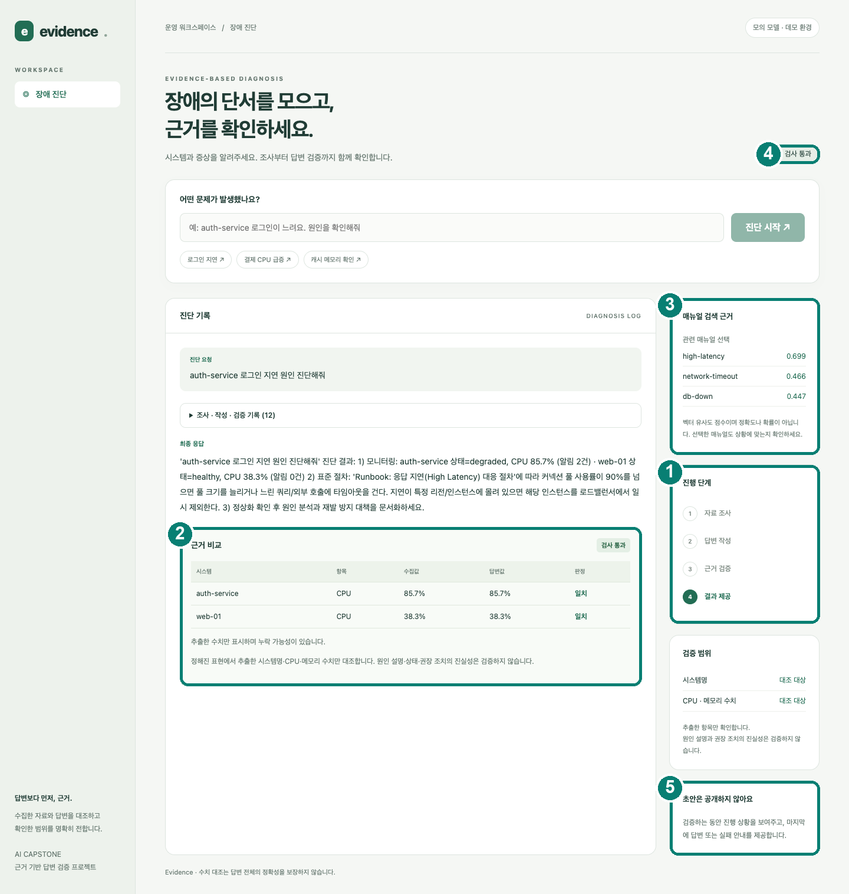

# 운영 장애 진단 에이전트: 근거 기반 검증·검색·조사 안정성 개선

AI Capstone 개인과제 / 김하연

수업에서 제공받은 Base AI Agent(운영 장애 진단, FastAPI·LangGraph·MCP·Vue)를 개선했다. 답변을 수집한 모니터링 자료와 대조해 틀린 수치를 막고, 매뉴얼을 의미로 검색하며, 일부 조사가 실패해도 확보한 자료로 진행하도록 바꾸고 그 근거를 화면에 보여준다.

수업 제공 코드와 문서는 공개 대상이 아니어서 이 저장소에 포함하지 않았다. 직접 만든 모듈, 평가 스크립트와 결과, 설계 기록, 보고서와 발표 자료만 담았으며, 이 저장소만으로는 에이전트가 실행되지 않는다. 전체 내용은 [결과보고서](submission/결과보고서.md)와 [발표 자료](submission/AI_Capstone_발표.pdf)에 있다.

## 평가 항목별 확인 위치

| 평가 항목 | 확인할 곳 |
|---|---|
| 기능 구현 완성도 | 동작 증거: [개선 전후 화면](#51-개선-전후-화면), [결과보고서 5절](submission/결과보고서.md), 테스트 6종과 실행 결과(`eval/`). 이 저장소에는 수업 제공 코드가 없어 전체 실행은 [8절](#8-재현-방법) 참고 |
| 기술 요소 반영도 | 아래 [3. 사용한 기술 요소](#3-사용한-기술-요소) 표, [결과보고서 4절](submission/결과보고서.md) |
| 한계·트레이드오프 | 아래 [6. 한계와 트레이드오프](#6-한계와-트레이드오프), [결과보고서 6절](submission/결과보고서.md) |
| 발표 자료 | [`submission/AI_Capstone_발표.pdf`](submission/AI_Capstone_발표.pdf) (문제, 개선, 전후 수치, 한계, 향후 개선 순서) |
| Before/After 실측 | 아래 [5.2 수치](#52-수치), [결과보고서 5절](submission/결과보고서.md) |

## 1. 문제

제공받은 에이전트에서 다음 문제를 확인했다.

1. 답변 검증이 형식(30자 이상, `1)` 포함)만 확인해서 수집 자료와 다른 수치도 통과했고, 3회 불합격하면 강제로 합격시켰다.
2. 매뉴얼을 키워드 규칙으로 골랐고, 찾지 못하면 `db-down`을 기본값으로 썼다.
3. 병렬 조사 중 하나가 실패하면 성공한 자료까지 버렸다.
4. 목록에 없는 시스템을 물으면 `auth-service`로 바꿔 조사하고도 그 사실을 알리지 않았다.
5. 모니터링 근거가 하나도 없어도 작성 모델을 호출했다.

## 2. 개선 내용

| 구분 | 개선 | 코드 |
|---|---|---|
| 답변 검증 | 답변의 시스템명·CPU·메모리 수치를 수집값과 대조한다. 불일치 사유로 재작성시키고, 최초 작성을 포함해 3회 실패하면 강제 합격 대신 "검증 실패"로 안내한다. 동의어·표·'각각'·영어 서술을 읽고 임계치·조건문·부정 수치는 측정값에서 제외한다 | `agent/verifier.py` |
| 매뉴얼 검색 | 로컬 임베딩으로 매뉴얼 6개와의 유사도를 구한다. 점수가 낮거나 1·2위 차이가 작으면 고르지 않고 미확정으로 둔다 | `agent/retrieval.py` |
| 조사 구조 | 조사를 monitoring·runbook 서브에이전트(LangGraph 서브그래프)로 나누고 research는 분배와 취합만 맡긴다. 작업별로 실패를 격리하고 실패한 대상은 답변에 한계로 표시한다 | `agent/subagents.py` |
| 대상 시스템 | 목록에 없는 시스템을 다른 시스템으로 바꾸지 않고 조사 실패로 안내한다. 시스템명이 아예 없을 때만 기본값을 쓰고 그 사실을 알린다 | `agent/targets.py` |
| 비용 | 모니터링 근거가 없으면 작성 모델을 호출하지 않고 "자료 부족"으로 종료한다 | `agent/nodes/evidence_gate.py` |
| 구조·화면 | 한 파일에 있던 노드를 모듈로 분리하고, 근거 비교표·검색 후보·검증 범위를 화면에 표시한다 | 제공 파일과 섞여 있어 미포함 |

병렬 조사 속도, 모델 분리 비용, 임베딩 비용은 제공받은 구조를 측정한 것이며 직접 구현한 기능이 아니다.

## 3. 사용한 기술 요소

| 기술 | 제공받은 것 | 직접 변경·활용 |
|---|---|---|
| LangGraph | 처리 흐름(route → … → finalize) | 검증 실패 분기, 근거 점검 노드 추가, research를 서브그래프로 분리 |
| Multi-Agent | 한 그래프 안의 역할별 노드 | monitoring·runbook 서브에이전트. LLM이 판단하지 않고 도구를 호출하는 얕은 형태 |
| MCP | 모니터링 도구, 매뉴얼, 표준 절차 프롬프트 | 매뉴얼 검색 도구 추가 |
| RAG | 매뉴얼 조회 | 의미 검색으로 선택한 매뉴얼 본문을 작성 모델에 제공 (외부 벡터 DB 없음) |
| 의존성 주입 | `SupervisorDeps`를 각 노드에 주입 | 서브에이전트에도 적용, 검증·검색 방식을 deps로 바꿔 개선 전후 비교, 테스트에서 가짜 객체로 교체 |
| LangSmith | 추적 코드 | 추적을 켜고 1회 실행해 새 노드가 같은 트리에 기록되는 것을 확인. 비교 평가는 하지 않음 |
| 모듈화 | `agent/` 패키지 | 노드 분리, `targets`·`subagents`·`verifier`·`retrieval` 모듈 신설 |
| 단위·통합 테스트 | 없음에 가까움 | 테스트 6종과 평가 스크립트(`eval/`) |

## 4. 처리 흐름

색을 넣은 노드가 개선한 부분이다. 작성은 최초 작성을 포함해 최대 3회(재작성 2회), 재조사는 1회로 제한했다.


## 5. 결과

### 5.1 개선 전후 화면

같은 질문에서 작성 모델이 CPU 수치를 15%p 높게 쓰도록 모의하고, 검증 설정만 바꿔 비교했다. 모의 모델로 재현한 결과이며 실모델 결과가 아니다.

| 개선 전 | 개선 후 |
|:---:|:---:|
|  |  |
| 수집값과 다른 CPU 100.5%, 54.8%가 그대로 최종 응답으로 나간다 | 3회 작성해도 일치하지 않아 답변을 내지 않고, 불일치 사유와 수집값, 비교표를 보여준다 |

아래는 실제 화면에서 같은 질문을 실행하는 과정을 연속 캡처해 이어 붙인 것이다. 모의 모델에 실제 MCP·임베딩을 연결한 환경이며, 실제 실행은 3~4초 걸리지만 읽기 쉽도록 늘려 재생한다.



정상 진단은 조사, 작성, 근거 검증 단계가 차례로 채워진 뒤 수집값과 답변값이 일치하는 비교표가 나온다.



정상 진단의 최종 화면은 [`submission/최종실행화면_신규.png`](submission/최종실행화면_신규.png)에서 볼 수 있다.

### 5.2 수치

| 항목 | 개선 전 → 후 | 비고 |
|---|---|---|
| 틀린 답변 차단 (동일 17개 입력) | 2/9 → 9/9 | 정상 답변 통과 8/8 유지 |
| 검증 규칙 확장 (28개) | 오류 차단 6/14 → 14/14, 정상 통과 7/14 → 14/14 | 약점을 겨냥해 만든 사례라 결과가 낙관적임 |
| 매뉴얼 선택 (14개) | 기대 일치 6/14 → 12/14 | 무관한 질문 미선택 0/2 → 2/2 |
| 근거 없는 질문의 응답 시간 | 36.6초 → 1.2~2.7초 | 단일 질문, 작성 모델 호출 1회 → 0회 |
| Ollama 실모델 (4문항 × 1회) | 작성 시도 1.0 → 1.0회, 시간 42.6초 → 43.3초 | 개선 효과를 주장하지 않음 |

규칙을 고치기 전에 평가 사례를 먼저 작성하고 개선 직전 검증기를 [`eval/baseline/`](eval/baseline/)에 보관해 같은 사례로 비교했다. 사례는 지목한 약점 28개, 설계 때 보지 못한 변형 6개, 개선 직후 점검에서 찾은 부작용 탐침 8개로 구성했다. 자세한 표는 결과보고서 5절에 있다.

## 6. 한계와 트레이드오프

개선이 새로 만든 약점은 다음과 같다.

- 임베딩 검색은 정확도를 얻는 대신 비용을 낸다. 임베딩 모델만 올린 상태에서 콜드 첫 검색 약 1.1초, 인덱스 재구축 약 0.28초, 웜 검색 약 29ms(기존 키워드 분류는 약 2µs)이고, 모델은 639MB이며 Ollama에 의존한다. 실서버 첫 요청에서 작성 모델과 메모리를 나눠 쓸 때는 9.64초가 관찰됐다. 인덱스는 메모리 캐시라 재시작할 때 다시 만든다.
- 재작성과 재조사 루프에는 한도를 두어 무한 반복을 막았다(최초 작성을 포함한 검증 3회, 재조사 1회). 한도에 닿으면 강제 합격이 아니라 실패를 안내한다.
- 시스템명 요구를 완화한 대가로, 수치가 없는 답변은 어느 시스템 이야기인지 확인하지 않고 통과한다.
- 반려될 초안을 노출하지 않기 위해 토큰 단위 스트리밍을 포기했다.

개선 과정에서 발견해 수정한 문제는 다음과 같다.

- 임계치와 조건문을 제외하는 규칙이 "CPU가 99% 이상 지속"처럼 틀린 측정값을 통과시켰다. 평가를 다시 돌려 찾아 고쳤고, 그 수정이 실제 런북 문장을 놓치는 회귀를 만들어 한 번 더 고쳤다.
- 외부 검토에서 조회하지 못한 시스템의 수치가 다른 시스템과 같으면 통과하는 버그, `oauth-service`와 `auth-service`처럼 비슷한 이름이 섞이는 버그가 발견되어 고쳤다.
- 실모델에서 재작성이 줄어든 것은 시스템명 요구를 완화한 영향이며 정확도 향상이 아니다. 시간은 같은 설정에서도 실행마다 두 배 넘게 달랐다.

남은 한계는 다음과 같다.

- 검증은 시스템명과 CPU·메모리 수치의 일치만 확인하며 원인 설명의 사실 여부는 판단하지 않는다. 규칙 기반이라 새로운 표현은 놓칠 수 있다.
- 수치는 직전에 나온 시스템명에 연결한다. 조회하지 못한 시스템을 설명한 문장 뒤에 다른 시스템의 수치가 오면 정상적인 서술도 반려될 수 있고, `customer-service`나 `top-10` 같은 일반 표현을 시스템으로 오인한다.
- 평가는 소규모 자체 데이터이고 실모델은 질문당 한 번만 실행했다. OpenAI 실모델과 LangSmith 기반 비교 평가는 하지 않았다.
- 서브에이전트는 LLM 판단 없이 도구를 호출하는 구조이며 성능상 이득은 없다.
- 반려될 초안을 노출하지 않기 위해 토큰 단위 스트리밍을 포기했다. 시스템명 요구를 완화한 대신 수치가 없는 답변은 대조 없이 통과한다.

## 7. 저장소 구성

```text
agent/
  verifier.py             근거 대조 검증기
  targets.py              대상 시스템 해석
  subagents.py            monitoring_agent, runbook_agent
  retrieval.py            임베딩 의미 검색
  nodes/evidence_gate.py  근거 점검 노드
eval/                     테스트, 평가·측정 스크립트, 실행 결과, baseline/
doc/                      설계 결정 기록(ADR 15개), 상세 평가 기록
submission/               결과보고서, 발표 PPT·PDF, 화면 캡처
```

재현 방법은 다음 절에 정리했다.

## 8. 재현 방법

### 8.1 이 저장소만으로 재현되는 것

Python 3.11 이상이면 되고 설치할 패키지는 없다.

```bash
git clone https://github.com/gkyeon/ai-capstone-gkyeon.git
cd ai-capstone-gkyeon
python3 eval/eval_verifier_v2.py      # 검증기 개선 전후 비교 (42개 사례)
python3 eval/test_evaluation_exit.py  # 평가 불일치가 실패 종료로 이어지는지 확인
```

`eval_verifier_v2.py`는 개선 직전 검증기 스냅샷([`eval/baseline/verifier_before_v2.py`](eval/baseline/verifier_before_v2.py))과 개선 후 [`agent/verifier.py`](agent/verifier.py)에 같은 사례를 넣어 비교한다. 출력은 사례 묶음별(T 28개, U 6개, V 8개) 개선 전후의 정상 통과·오류 차단 수이며, 5.2절의 값(예: T는 정상 7/14 → 14/14, 오류 6/14 → 14/14)과 같아야 한다. 개선 후 결과가 기대와 다른 사례가 있으면 해당 사례를 출력하고 종료 코드 1로 끝난다. 저장소 파일은 수정하지 않는다.

### 8.2 수업 제공 기본 프로젝트가 필요한 것

| 항목 | 스크립트 | 추가로 필요한 것 |
|---|---|---|
| 그래프·서브에이전트·근거 점검 테스트 | `eval/test_*.py`, `eval/run_tests.sh` | 기본 프로젝트의 `agent/`, `data/`와 원본을 수정한 파일 |
| 대상 시스템·검증 전후 비교 | `eval/eval_targets.py`, `eval/eval_validator.py` | 위와 동일 |
| 매뉴얼 검색, 임베딩 비용 | `eval/eval_search.py`, `eval/measure_embedding.py` | 위와 동일 + Ollama, `qwen3-embedding:0.6b` |
| 실모델 비교 | `eval/run_live_ollama.py` | 위와 동일 + `qwen3:8b`, `qwen2.5:0.5b` |

원본을 수정한 파일(`server.py`, `graph.py`, 노드 모듈, `web_chat.html` 등)이 이 저장소에 없어서 **이 저장소만으로 전체 에이전트를 재현할 수는 없다.** 해당 실험의 결과는 `eval/`에 저장된 결과 파일과 결과보고서 5절로 확인한다.

## 9. 화면 사용법

화면(`web_chat.html`)은 수업 제공 파일을 수정한 것이라 이 저장소에 없다. 아래는 전체 프로젝트가 있는 환경 기준의 설명이다.

실행은 백엔드와 화면 서버를 각각 띄운다. 모의 모델은 Ollama 생성 모델 없이 전체 흐름을 보여준다. 의미 검색에는 임베딩 모델이 필요하며, 없으면 `RETRIEVAL_MODE=legacy`로 실행한다.

```bash
# 터미널 1: 백엔드 (포트 8100)
LLM_BACKEND=fake VALIDATOR_MODE=grounded RETRIEVAL_MODE=semantic python server.py
# 터미널 2: 화면 (포트 8600) -> http://127.0.0.1:8600
python -m uvicorn web_demo_server:app --host 127.0.0.1 --port 8600
```

실행되는 모습은 5.1절의 GIF에 있다. 사용 순서는 질문을 입력하거나 예시 칩(로그인 지연, 결제 CPU 급증, 캐시 메모리 확인)을 누르고 "진단 시작"을 누르는 것이다. 완료되면 다음이 표시된다.

| 화면 영역 | 내용 |
|---|---|
| 진단 기록 | 질문, 조사·작성·검증 단계 기록(접힘), 최종 응답, 근거 비교표(시스템·항목·수집값·답변값·판정) |
| 매뉴얼 검색 근거 | 의미 검색 후보와 유사도 점수. 점수는 확률이 아니다 |
| 진행 단계 | 자료 조사, 답변 작성, 근거 검증, 결과 제공 |
| 검증 범위 | 대조한 항목(시스템명, CPU·메모리 수치)과 검증하지 않는 것 |
| 상단 상태 | 검사 통과, 검증 실패, 자료 부족·검증 불가, 연결 확인 필요 |

시연에 쓴 질문과 기대 동작은 다음과 같다.

| 질문 또는 설정 | 기대 동작 |
|---|---|
| `auth-service 로그인 지연 원인 진단해줘` | 검사 통과, 비교표의 수집값과 답변값 일치 |
| `billing-service 응답이 느려요` | 모니터링 대상에 없는 시스템이라는 안내. 모의 모델은 연관 시스템(web-01)을 함께 조사해 그 기준으로 답하고, 실모델에서 근거가 없으면 "자료 부족으로 검증할 수 없다"로 끝남 |
| `FAKE_DRAFT_MODE=always_wrong`로 백엔드 실행 | 3회 작성 후 검증 실패, 불일치 사유와 수집값 표시 |
| 위 설정에 `VALIDATOR_MODE=legacy` | 개선 전 동작. 틀린 수치가 그대로 최종 응답으로 나옴 |

화면의 번호는 발표 자료 6번 슬라이드와 같다.



1. 진행 단계, 2. 수집값과 답변값 비교표, 3. 매뉴얼 검색 근거(후보와 유사도), 4. 상태 표시, 5. 초안 비공개 안내이다. 정상 완료와 구분되는 상태는 [검증 실패](submission/화면_상태_검증실패.png)와 [자료 부족·검증 불가](submission/화면_상태_자료부족.png) 화면에서 볼 수 있고, 발표 5번 슬라이드의 화면은 [`submission/화면_최종실행.png`](submission/화면_최종실행.png)이다.

`FAKE_DRAFT_MODE`의 값은 `normal`, `wrong_cpu_once`(1회만 틀리고 재작성으로 정정), `cross_system`(다른 시스템 수치 혼용), `always_wrong`이다.

## 10. 실험 환경

| 항목 | 내용 |
|---|---|
| 장비·OS | Apple Silicon(arm64), macOS 26.5 |
| Python | 3.14 (전체 프로젝트), 3.11 (7.1의 단독 실행 확인) |
| 주요 패키지 | langgraph 1.2.16, langchain-core 1.6.12, langsmith 0.14, fastmcp 4.1, mcp 2.3, fastapi 0.150, uvicorn 0.54, pydantic 2.14 |
| 로컬 모델(Ollama 0.33) | 작성 `qwen3:8b`, 분류·계획 `qwen2.5:0.5b`, 임베딩 `qwen3-embedding:0.6b` |
| 기타 | LangSmith 추적은 1회 실행해 기록 구조만 확인, OpenAI 실모델은 사용하지 않음 |
