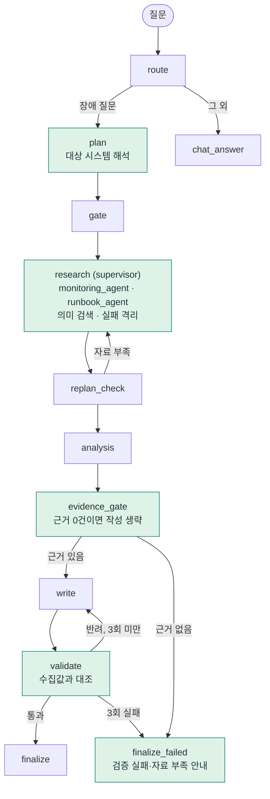

<div align="center">

# 운영 장애 진단 에이전트
### 근거 기반 검증 · 검색 · 조사 안정성 개선

AI Capstone 개인과제 — 수업에서 제공받은 **Base AI Agent**를 개선했습니다.


</div>

> [!NOTE]
> **먼저 알아둘 것** — 수업 제공 코드·문서(기본 프로젝트, 매뉴얼, 실행 스크립트, 샘플 데이터)는 공개할 수 없어 **포함하지 않았습니다.** 그래서 이 저장소만으로는 에이전트가 실행되지 않습니다. 직접 만든 모듈, 평가와 그 결과, 설계 기록, 보고서·발표 자료만 담았습니다.

| 읽는 시간 | 볼 곳 |
|---|---|
| **1분** | 아래 "30초 요약"과 "화면으로 보기" |
| **5분** | [`submission/결과보고서.md`](submission/결과보고서.md) 1~4절, [`submission/AI_Capstone_발표.pdf`](submission/AI_Capstone_발표.pdf) |
| **20분** | [`doc/ADR.md`](doc/ADR.md) → 코드 → [`eval/`](eval/) |

**목차** — [30초 요약](#30초-요약) · [화면으로 보기](#화면으로-보기) · [핵심 개선 3가지](#핵심-개선-3가지) · [추가 개선](#추가-개선) · [처리 흐름](#처리-흐름) · [결과](#결과) · [솔직한 메모](#솔직한-메모) · [저장소 구성](#저장소-구성)

---

## 30초 요약

| 제공받은 에이전트의 문제 | → | 개선 | → | 효과 |
|---|---|---|---|---|
| 답변을 **형식만** 검사해서 틀린 수치도 통과. 3회 불합격하면 **강제 합격** | | 수집한 자료와 **수치를 대조**, 끝내 실패하면 "검증 실패" 안내 | | 틀린 답변 차단 **2/9 → 9/9** |
| 매뉴얼을 **키워드**로 선택 (못 찾으면 `db-down`) | | 임베딩 **의미 검색** | | 기대 일치 **6/14 → 12/14** |
| 조사 하나가 실패하면 **성공한 자료까지 버림** | | 작업별 **실패 격리** + 한계 표시 | | 부분 자료로 진행 |

> [!IMPORTANT]
> 위 수치는 모두 **자체 평가**입니다. 약점을 겨냥한 사례는 낙관적이고, 실모델은 질문당 1회만 돌렸습니다. 한계와 스스로 찾은 결함은 [솔직한 메모](#솔직한-메모)에 그대로 적었습니다.

## 화면으로 보기

같은 질문, 같은 틀린 답변(모의 모델이 CPU를 15%p 높게 씀)에서 **검증 설정만** 바꿨습니다. 모의 모델 재현이며 실모델 결과가 아닙니다.

| 개선 전 — 형식만 검사 | 개선 후 — 수집값과 대조 |
|:---:|:---:|
|  |  |
| 수집값과 다른 CPU **100.5%·54.8%** 가 근거 표시 없이 **그대로 최종 응답** | 3회 재작성해도 불일치 → **답변을 내지 않고** 사유·실제 수집값·비교표를 보여줌 |

정상 진단 화면(근거 비교표 · 매뉴얼 검색 후보와 점수 · 검증 범위): [`submission/최종실행화면_신규.png`](submission/최종실행화면_신규.png)

## 핵심 개선 3가지

### ① 답변을 수집 자료와 대조한다 — [`agent/verifier.py`](agent/verifier.py)
답변에 적힌 **시스템명·CPU·메모리 수치**를 수집값과 비교합니다. 틀리면 무엇이 어떻게 다른지 작성 단계에 돌려줍니다.

```text
auth-service의 CPU 사용률은 수집값 81.7%인데 답변에는 96.7%로 적혀 있습니다. 수집된 값을 그대로 인용하세요.
```

세 번 연속 맞추지 못하면 초안은 버리고 **실패 사유와 수집값만** 안내합니다(강제 합격 없음). 동의어·표·'각각'·영어 서술을 읽고, 임계치·조건문("CPU 90% 이상 지속 시")은 측정값으로 보지 않습니다.
검증하는 것은 **수치의 일치**뿐이며, 원인 설명의 사실 여부는 판정하지 않습니다.

### ② 매뉴얼을 의미로 찾는다 — [`agent/retrieval.py`](agent/retrieval.py)
로컬 임베딩 모델로 매뉴얼 6개와의 유사도를 계산합니다. 점수가 낮거나 1·2위 차이가 작으면 **고르지 않고** "미확정"으로 둡니다. 대가로 콜드 시작 지연(약 1초)과 모델 639MB가 생깁니다.

### ③ 일부가 실패해도 확보한 자료로 진행한다 — [`agent/subagents.py`](agent/subagents.py)
조사를 `monitoring_agent`와 `runbook_agent` 두 **서브에이전트**(LangGraph 서브그래프)로 나누고, research는 분배·병렬 실행·취합만 하는 supervisor입니다. 작업별로 실패를 가두고, 실패한 대상은 답변에 **한계로 표시**합니다.

## 추가 개선

<details>
<summary><b>펼쳐서 보기 — 4가지</b></summary>

| # | 기본 기능의 문제 | 개선 | 효과 | 위치 |
|---|---|---|---|---|
| ④ | 없는 시스템을 **몰래 auth-service로 바꿔 조사** | 바꾸지 않고 조사 실패로 안내, 이름이 없을 때만 기본값을 쓰되 알림 | 묻지 않은 시스템 답변 방지 | [`agent/targets.py`](agent/targets.py) |
| ⑤ | 근거가 없어도 비싼 작성 모델 호출 | 모니터링 근거 0건이면 작성 생략 → "자료 부족" | 36.6초 → **1.2~2.7초**, 호출 1 → 0회 (단일 질문) | [`agent/nodes/evidence_gate.py`](agent/nodes/evidence_gate.py) |
| ⑥ | 한 파일(425줄)에 모든 노드 | `state.py` + `nodes/` 6개 모듈로 분리 | 구조 정리, 동작 변경 없음 | 원본과 섞여 미포함 |
| ⑦ | 반려될 초안이 화면에 남고 근거가 안 보임 | 초안 차단, 근거 비교표·검색 후보·검증 범위 표시 | 화면에서 근거 확인 | 화면 캡처 |

**측정만 한 것(직접 구현이 아님)**: 병렬 vs 직렬 조사 약 3배(원본의 0.35초/태스크 시뮬레이션 지연 포함), fast/quality 모델 분리 약 59% 절감 추정(글자수 기반·가정 단가), 임베딩의 대가(웜 검색 약 29ms).

</details>

## 처리 흐름

초록색이 개선한 노드입니다. 강제 합격 경로는 없어졌고, 재작성은 최대 3회·재조사는 1회로 제한해 무한 반복을 막았습니다.



## 결과

| 항목 | 결과 | 신뢰도 |
|---|---|:---:|
| 틀린 답변 차단 (같은 17개 입력) | **2/9 → 9/9**, 정상 통과 8/8 유지 | ⚠️ 자체 평가셋 |
| 검증 규칙 (표적 28개) | 정상 7/14 → 14/14, 오류 6/14 → 14/14 | ⚠️ 약점을 겨냥한 사례라 낙관적 |
| 매뉴얼 선택 (14개) | **6/14 → 12/14**, 무관 질문 미선택 0/2 → 2/2 | ⚠️ 자체 14개, 점수는 확률 아님 |
| 근거 없는 질문 응답 | **36.6초 → 1.2~2.7초**, 작성 호출 1 → 0회 | ⚠️ 단일 질문 |
| Ollama 실모델 (4문항×1회) | 작성 시도 1.0 → 1.0회, 시간 42.6초 ↔ 43.3초 | ✅ 개선을 **주장하지 않음** |

**평가 방식** — 규칙을 고치기 **전에** 사례를 먼저 쓰고, 개선 직전 검증기를 [`eval/baseline/`](eval/baseline/)에 스냅샷으로 보관해 같은 사례로 비교했습니다. 사례는 세 묶음입니다: 지목한 약점 28개 · 설계 때 보지 못한 변형 6개 · 개선 직후 자체 점검에서 찾은 부작용 탐침 8개. 자세한 표는 [결과보고서](submission/결과보고서.md) 5절.

## 솔직한 메모

> [!WARNING]
> 개선 과정에서 **제가 만든 결함도 있었고**, 평가를 다시 돌리거나 외부 검토를 받아 찾아 고쳤습니다.

- 임계치·조건문을 제외하는 규칙이 처음에 "CPU가 99% 이상 지속"처럼 **틀린 측정값을 통과**시켰습니다. 고쳤더니 이번엔 실제 런북 문장을 놓치는 회귀가 생겨 한 번 더 고쳤습니다.
- 외부 검토에서 **미조회 시스템의 수치가 다른 시스템과 같으면 통과**하는 버그, **비슷한 이름(oauth-service ↔ auth-service)이 섞이는** 버그가 나와 고쳤습니다.
- 실모델에서 재작성이 줄어 보였지만 정확도 향상이 아닙니다. 시스템명 요구를 완화한 영향이고, 개선 전도 처음부터 1.0회였습니다. 시간은 같은 설정에서도 실행마다 두 배 넘게 달랐습니다.
- 비용 절감 추정이 47%에서 59%로 바뀐 건, 검증 오탐 때문에 있던 불필요한 재작성이 사라진 효과였습니다.

<details>
<summary><b>남은 한계 (펼치기)</b></summary>

- 검증은 수치의 일치만 봅니다. 규칙 기반이라 새 표현을 놓칠 수 있습니다.
- 수치-시스템 연결은 "직전에 나온 시스템명" 규칙이라, 미조회 시스템 설명 뒤에 다른 시스템의 수치가 오면 정직한 서술도 반려할 수 있습니다. 시스템 이름 꼴 규칙은 `customer-service`·`top-10` 같은 일반 표현을 시스템으로 오인합니다.
- 평가는 소규모 자체 데이터이고 실모델은 질문당 한 번씩만 돌렸습니다. OpenAI 실모델과 LangSmith 기반 비교 평가는 하지 않았습니다(추적 기록 확인만).
- 서브에이전트는 LLM 판단 없이 도구를 호출하는 작업자이며 성능 이득은 없습니다.
- 초안 비공개를 위해 토큰 단위 스트리밍을 포기했고, 시스템명 요구를 완화한 대가로 수치 없는 답변은 대조 없이 통과합니다.

</details>

## 저장소 구성

```text
agent/
  verifier.py             근거 대조 검증기
  targets.py              대상 시스템 해석 (known / unknown / defaulted)
  subagents.py            monitoring_agent · runbook_agent (LangGraph 서브그래프)
  retrieval.py            임베딩 의미 검색
  nodes/evidence_gate.py  근거 0건이면 작성 생략
eval/                     테스트 6종 · 평가·측정 스크립트 · 실행 결과(JSON/MD) · baseline/
doc/                      ADR(설계 결정 15개) · 체크리스트 · 검증 설명 · LangSmith 확인 절차
submission/               결과보고서 · 발표 PPT/PDF · 대본 · 화면 캡처
```

`eval/`의 테스트·평가 스크립트는 수업 제공 기본 프로젝트(그래프·MCP 서버·샘플 데이터)가 같은 위치에 있어야 실행됩니다. 결과 파일(`eval/*-20261021.*`, `eval/results.md`)은 실행 결과 그대로 올렸으니, 읽는 방법은 보고서 5절을 보세요.
