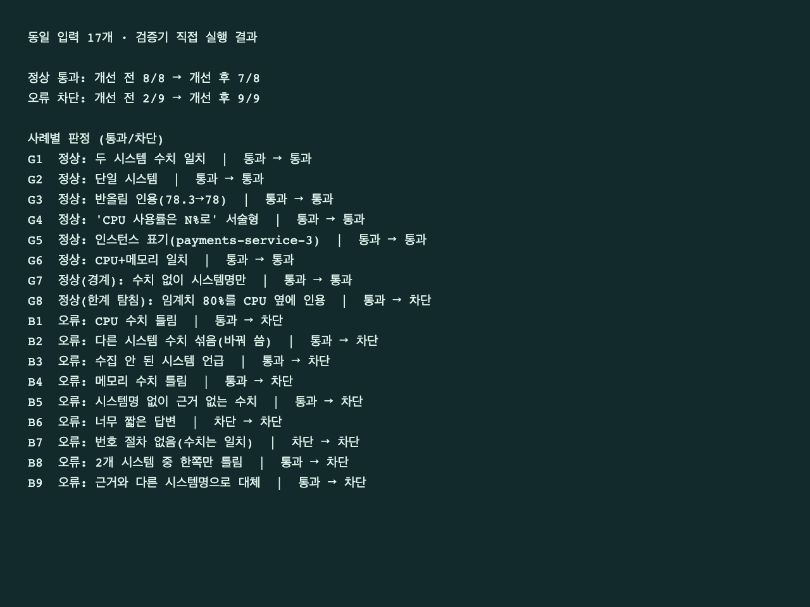

# 결과보고서: 운영 장애 진단 에이전트의 근거 기반 검증·검색·조사 안정성 개선

(작성: 2026-10-21. 이전 버전은 답변 검증만 다뤘으며, 이 문서는 의미 검색·부분 실패 처리·새 화면·서브에이전트 분리·대상 시스템 해석·검증 규칙 2차 개선·노드 모듈화와 확장 후 실모델 재시험까지 반영했다.)

## 1. 문제와 목표

제공받은 운영 장애 대응 에이전트와 1차 개선 결과에는 여섯 가지 구체적인 문제가 있었다.

1. **답변 검증이 형식만 봤다.** 답변이 30자 이상이고 `1)`을 포함하면 통과했다. 수집 자료와 수치가 달라도 통과했고, 세 번 불합격하면 강제로 합격시켰다. 피드백도 "짧다"로 고정이었다.
2. **매뉴얼 선택이 키워드 규칙이었다.** 증상 표현이 키워드와 다르면 기본값 `db-down`을 골랐다. (동일 14개 문장 중 기존 방식이 기대와 일치한 것은 6개)
3. **병렬 조사 중 한 작업이 예외를 내면 성공한 자료까지 버려졌다.**
4. **대상 시스템 폴백이 숨겨져 있었다.** 목록에 없는 시스템(billing-service)을 물으면 실모델 계획 정규화가 조용히 `auth-service`로 바꿨다. 사용자가 묻지 않은 시스템에 대한 근거 있는 답변이 만들어진다.
5. **1차 검증기의 규칙 한계가 실측됐다.** 시스템명 누락이 실모델 재작성의 대부분을 만들었고, 한글 동의어·숫자가 먼저 오는 문장·표·부정문·'각각'·임계치 인용을 놓치거나 잘못 반려했다.
6. **그래프 노드가 `graph.py` 한 파일(425줄)에 섞여 있었다.**

목표는 (1) 답변의 시스템명·CPU(중앙처리장치)·메모리 사용률을 수집 자료와 대조해 불일치 시 구체적으로 재작성시키고 실패하면 강제 합격 대신 실패를 안내하는 것, (2) 매뉴얼을 의미 기반으로 검색하는 것, (3) 일부 조사가 실패해도 확보한 자료로 진행하되 한계를 표시하는 것, (4) 이 과정을 사용자가 근거와 함께 볼 수 있는 화면으로 제공하는 것이다. 원인 설명 전체의 진실성 판정은 목표가 아니다.

## 2. 개선 구조

수집(모니터링·매뉴얼 검색) → 초안 작성 → 근거 대조 → 통과 시 최종 답변 / 반려 시 구체적 피드백으로 재작성 / 총 3회 실패 시 실패 안내.

| 영역 | 변경 내용 | 파일 |
|---|---|---|
| 답변 검증 | 시스템명·CPU·메모리 %를 수집값과 대조(허용 오차 0.5%p). 불일치 사유를 문장으로 작성 단계에 전달. 총 3회 실패 시 강제 합격 대신 "검증 실패" 안내. 자료 없으면 검증 불가로 종료. 검증 보고표(추출 항목·판정·범위) 제공 | `agent/verifier.py`, `agent/graph.py` |
| 매뉴얼 검색 | 로컬 임베딩(qwen3-embedding:0.6b)으로 6개 매뉴얼의 코사인 유사도 검색. MCP 도구 `search_incident_runbooks`로 제공. 점수 0.45 미만 또는 상위 두 후보 차이 0.025 미만이면 "미확정" | `agent/retrieval.py`, `mcp_server.py` |
| 대상 시스템 해석 | 시스템 목록·해석을 `targets.py`로 모아 known/unknown/defaulted를 구분. 목록에 없는 시스템은 auth-service로 바꾸지 않고 조사 실패로 드러냄, 이름이 없을 때만 기본값을 쓰되 이벤트·답변 첫머리에 알림, 계획 노드가 모델이 빠뜨린 대상을 추가 | `agent/targets.py`, `agent/nodes/planning.py` |
| 검증 규칙 2차 | 지표 동의어·'99%의 CPU'·표·'각각'·영어 서술, 임계치·조건문·부정 수치 제외(부정 뒤 수치는 대조), 시스템명은 수치 인용 시에만 요구, 미조회 시스템 언급 허용 | `agent/verifier.py` |
| 노드 모듈화 | `graph.py`를 `state.py`+`nodes/`(routing·planning·research·writing·validation·finalization)로 분리. 동작 변경 없음 | `agent/nodes/*.py`, `agent/graph.py` |
| 근거 점검(비용) | 모니터링 근거가 0건이면 작성 모델을 부르지 않고 "자료 부족"으로 조기 종료(`evidence_gate`, ADR-14) | `agent/nodes/validation.py`, `agent/graph.py` |
| 조사 구조 분리 | research를 `monitoring_agent`·`runbook_agent` 두 서브에이전트(컴파일된 LangGraph 서브그래프)로 분리하고 research_node는 supervisor로 분배·병렬·취합만 담당. 처리한 에이전트를 이벤트에 기록 | `agent/subagents.py`, `agent/graph.py` |
| 조사 실패 격리 | 작업별 예외 수집, 성공 자료 유지, 도구별 시간 제한(모니터링 15초·검색 60초), unknown 상태의 기본값 0을 근거로 쓰지 않음, 실패 대상을 최종 답변에 표시 | `agent/graph.py` |
| 화면 | 진행 단계, 최종 답변, 수치 비교표, 검색 후보·점수, 검증 범위. 반려된 초안은 서버·화면에서 차단. 실패·연결 오류 상태 표시 | `web_chat.html`, `server.py` |
| 비교용 설정 | `VALIDATOR_MODE=legacy\|grounded`, `RETRIEVAL_MODE=legacy\|semantic`, `FAKE_DRAFT_MODE`(오류 답변 재현) | `server.py`, `agent/fake_llm.py` |

설계 결정과 비용은 `doc/ADR.md`(ADR-01~15)에 정리했다. ADR-05~09는 제공받은 구조의 결정이며, 우리가 한 일은 측정과 확장임을 구분해 적었다.

## 3. 사용한 기술 요소: 기존 기반과 직접 변경

| 기술 | 기존 기반(제공) | 직접 변경·활용 |
|---|---|---|
| LangGraph | route→plan→gate→research→replan_check→analysis→write→validate→finalize | validate 실패 한도 도달 시 `finalize_failed` 분기, `should_replan`/`is_sufficient` 분리, research를 서브그래프 에이전트로 분리 |
| MCP (Model Context Protocol) | 모니터링 도구·매뉴얼 자료·프롬프트 | **검색 도구 `search_incident_runbooks` 추가** |
| 검색 증강 생성(RAG) 흐름 | 매뉴얼 조회 | 질문+수집 알림으로 의미 검색 → 선택된 매뉴얼 본문을 작성 모델에 제공 (외부 벡터 DB·청크 분할은 없음) |
| 병렬 실행 | `asyncio.gather` 조사 | `return_exceptions`로 부분 실패 격리 |
| 모듈화 | `agent/` 패키지(graph.py 단일 파일 중심) | `state.py`·`nodes/` 6개 모듈·`targets.py`·`subagents.py`·`verifier.py`·`retrieval.py` 분리(ADR-13), 동작 변경 없음 |
| 의존성 주입(DI) | `SupervisorDeps`를 `functools.partial`로 각 노드에 주입 | 서브에이전트도 같은 방식으로 deps를 주입받고, `validator_mode`·`retrieval_mode`를 deps로 전환해 개선 전후를 비교한다. 테스트는 deps를 모킹(`SimpleNamespace`·가짜 MCP)으로 갈아 끼운다 |
| 단위·통합 테스트 | 없음에 가까움 | `eval/test_*.py` 6종(검증·확장·서브에이전트·근거 점검·리뷰 회귀·평가 종료 코드)과 평가 스크립트, 실행기 `bash eval/run_tests.sh` |
| FastAPI·SSE·SQLite 세션 | 서버, 진행 이벤트 스트리밍, 대화 이력 저장 | metadata 확장, 초안 토큰 차단 |
| 모델 분리(fast/quality) | 분류·계획은 저비용, 작성은 고성능 모델 | 효과를 추정으로 측정(5.6), **근거가 없으면 작성 모델 호출 생략**(5.10) |
| LangSmith | `@traceable` 추적 코드 | 추적을 켜고 1회 실행해 **서브에이전트·근거 점검·검증 노드가 같은 트리에 기록됨을 확인**(5.12). 이외 실험은 추적을 끄고 실행했고, **LangSmith 기반 비교 평가는 수행하지 않음** |
| Multi-Agent | 하나의 그래프 안의 역할별 노드(supervisor 구조) | **research를 monitoring/runbook 서브에이전트로 분리**(ADR-10). 두 에이전트는 도구를 호출하는 작업자이며 LLM이 판단하지 않고 서로 협상하지 않는다 |

## 4. 구현 화면

### 4.1 최종 실행 화면 (정상 진단)

실제 로컬 서버(백엔드 + MCP + 실제 임베딩 모델)에 **모의 작성 모델**을 연결해 질문한 화면이다. 모의 모델은 정해진 응답을 낸다.


### 4.2 선택 전후 비교 화면 (같은 틀린 답변, 같은 화면)

`FAKE_DRAFT_MODE=always_wrong`로 작성 모델이 항상 CPU를 15%p 높게 쓰게 한 동일한 조건에서, 검증 설정만 바꿔 같은 질문을 실행했다. 모의 모델 기반의 재현이며 실모델 결과가 아니다.

**개선 전** (`VALIDATOR_MODE=legacy`): 수집값과 다른 CPU 100.5%, 54.8% 답변이 근거 표시 없이 그대로 최종 응답이 됐다.


**개선 후** (`VALIDATOR_MODE=grounded`): 3회 재작성에도 일치하지 않아 답변을 제공하지 않고, 불일치 사유와 수집 자료에서 직접 확인된 값, 근거 비교표를 보여준다.


모바일(390px) 화면 캡처: `모바일화면_신규.png` (구현 중 자동 화면 점검에서 가로 넘침이 없음을 확인).

### 4.3 동일 입력 17개의 검증 전후 (텍스트 캡처)



## 5. 평가

실험은 목적별로 구분했다. 오프라인 평가는 같은 입력을 두 구현에 직접 넣은 구성요소 비교다. 모의 모델은 처리 경로를 확인하는 용도다. 실모델은 실제 생성 답변의 동작과 시간을 관찰한다.

### 5.1. 오프라인 평가셋 (동일 사례 17개: 정상 8, 오류 9, G8은 한계 탐침)

| 사례 | 설명 | 기대 | 개선 전 | 개선 후 | 개선 후 검출 사유 |
|---|---|---|---|---|---|
| G1 | 정상: 두 시스템 수치 일치 | 통과 | 통과 | 통과 |  |
| G2 | 정상: 단일 시스템 | 통과 | 통과 | 통과 |  |
| G3 | 정상: 반올림 인용(78.3→78) | 통과 | 통과 | 통과 |  |
| G4 | 정상: 'CPU 사용률은 N%로' 서술형 | 통과 | 통과 | 통과 |  |
| G5 | 정상: 인스턴스 표기(payments-service-3) | 통과 | 통과 | 통과 |  |
| G6 | 정상: CPU+메모리 일치 | 통과 | 통과 | 통과 |  |
| G7 | 정상(경계): 수치 없이 시스템명만 | 통과 | 통과 | 통과 |  |
| G8 | 정상(한계 탐침): 임계치 80%를 CPU 옆에 인용 | 통과 | 통과 | 1차 개선 직후 차단 ❌ → **2차 개선(임계치 해석) 후 통과** | (1차) cpu_percent_mismatch |
| B1 | 오류: CPU 수치 틀림 | 차단 | 통과 | 차단 | cpu_percent_mismatch |
| B2 | 오류: 다른 시스템 수치 섞음(바꿔 씀) | 차단 | 통과 | 차단 | cpu_percent_mismatch, cpu_percent_mismatch |
| B3 | 오류: 수집 안 된 시스템 언급 | 차단 | 통과 | 차단 | unknown_system |
| B4 | 오류: 메모리 수치 틀림 | 차단 | 통과 | 차단 | memory_percent_mismatch |
| B5 | 오류: 시스템명 없이 근거 없는 수치 | 차단 | 통과 | 차단 | no_system, cpu_percent_unsupported |
| B6 | 오류: 너무 짧은 답변 | 차단 | 차단 | 차단 | format, no_system |
| B7 | 오류: 번호 절차 없음(수치는 일치) | 차단 | 차단 | 차단 | format |
| B8 | 오류: 2개 시스템 중 한쪽만 틀림 | 차단 | 통과 | 차단 | cpu_percent_mismatch |
| B9 | 오류: 근거와 다른 시스템명으로 대체 | 차단 | 통과 | 차단 | unknown_system, no_system, cpu_percent_unsupported |

| 지표 | 개선 전 | 개선 후 |
|---|---|---|
| 잘못된 답변 차단율 | 2/9 (22%) | 9/9 (100%) |
| 정상 답변 통과율 | 8/8 (100%) | 1차 개선 직후 7/8 (88%) → 2차 개선 후 8/8 (100%) |
| 검증 1회 평균 시간 | 0.4µs | 7.0µs |


### 5.2. 그래프 전체 실행 (fake LLM + 실제 MCP, 질문: `auth-service 로그인 응답이 느려요. 장애 원인 확인해주세요`)

| 작성 모드 | 검증기 | 총 작성 시도 횟수 | 최종 결과 | 소요 시간 |
|---|---|---|---|---|
| normal | legacy | 2 (불합격 → 합격) | 근거와 일치하는 답변 | 1.16s |
| normal | grounded | 2 (불합격 → 합격) | 근거와 일치하는 답변 | 0.73s |
| wrong_cpu_once | legacy | 2 (불합격 → 합격) | ⚠️ 틀린 답변이 그대로 최종 응답 | 0.73s |
| wrong_cpu_once | grounded | 3 (불합격 → 불합격 → 합격) | 근거와 일치하는 답변 | 0.73s |
| cross_system | legacy | 2 (불합격 → 합격) | ⚠️ 틀린 답변이 그대로 최종 응답 | 0.74s |
| cross_system | grounded | 3 (불합격 → 불합격 → 검증 실패) | 검증 실패(답변 미제공) | 0.73s |
| always_wrong | legacy | 2 (불합격 → 합격) | ⚠️ 틀린 답변이 그대로 최종 응답 | 0.73s |
| always_wrong | grounded | 3 (불합격 → 불합격 → 검증 실패) | 검증 실패(답변 미제공) | 0.73s |

### 5.3. 추가 검증과 후속 개선

코드 확인 후 취약점 탐색을 위해 판정 사례 13개와 정책·범위 탐침 3개를 추가했다. 판정 사례 중 7개는 기대와 일치했고, 6개는 불일치했다. 이는 약점을 의도적으로 겨냥한 평가로 일반 정확도를 추정하는 표본이 아니다.

| 구분 | 관찰 |
|---|---|
| 오류 누락 3개 | 한글 동의어, 숫자가 먼저 등장하는 문장, 표 형식의 잘못된 수치가 통과 |
| 정상 반려 3개 | 부정문, 임계치와 현재값 혼합, ‘각각’ 표현을 반려 |
| 범위 탐침 | 근거 없는 원인 확정은 통과. 수치·시스템명이 없는 일반 답변은 반려 |
| 자료 부재 | 당시에는 통과했으나 후속 구현에서 검증 불가 종료로 수정 |
| 화면 노출 | 이전에는 반려 초안이 남았으나 후속 구현에서 초안 전송·표시 차단 |

1차 개선 직후 후속 기능 테스트에서는 기존 평가셋 결과(정상 7/8 통과, 오류 9/9 차단)가 유지됐고, 2차 개선(5.7) 후에는 정상 8/8 통과, 오류 9/9 차단이다. 통과·재작성·세 번째 실패·자료 부족 네 경로와 비교표의 일치·불일치·수치 미추출 상태를 확인했다. 실제 화면 코드에 모의 실패 이벤트를 전달해 초안 미노출·비교표·범위 안내를 확인했으며 페이지 오류는 없었다. 실제 로컬 HTTP 서버와 모의 모델 및 MCP(Model Context Protocol, 모델 컨텍스트 프로토콜) 연결에서도 초안 토큰 미전송과 비교표 전달을 확인했다.

### 5.4. 매뉴얼 검색 평가 (자체 사례 14개: 장애 12, 무관 2)

같은 문장을 기존 알림 키워드 분류기와 새 의미 검색에 각각 넣어 기대 매뉴얼과 비교했다. 전체 에이전트 정확도가 아니라 구성요소 비교이며, 임계값은 결과를 보고 조정하지 않았다.

| 질문(요약) | 기대 | 기존 | 의미 검색(점수) |
|---|---|---|---|
| 로그인 요청은 성공하지만 응답이 느림 | high-latency | db-down ❌ | high-latency (0.665) ✅ |
| 커넥션 풀 사용률 95% | high-latency | db-down ❌ | 미확정 (0.541 vs 0.521) ❌ |
| 프로세서 사용률이 치솟음 | cpu-spike | db-down ❌ | cpu-spike (0.669) ✅ |
| CPU usage reached 95 percent | cpu-spike | cpu-spike ✅ | cpu-spike (0.727) ✅ |
| 프로세스가 메모리를 반환하지 않음 | memory-leak | db-down ❌ | memory-leak (0.656) ✅ |
| heap keeps growing after GC | memory-leak | memory-leak ✅ | memory-leak (0.562) ✅ |
| 요청이 시간 제한을 초과하며 끊김 | network-timeout | db-down ❌ | high-latency (0.642 vs 0.605) ❌ |
| network timeout between services | network-timeout | network-timeout ✅ | network-timeout (0.757) ✅ |
| 로그 파일이 쌓여 저장 불가 | disk-full | db-down ❌ | disk-full (0.637) ✅ |
| disk space is full | disk-full | disk-full ✅ | disk-full (0.758) ✅ |
| DB 접속 불가·프로세스 종료 | db-down | db-down ✅ | db-down (0.598) ✅ |
| database down, connections refused | db-down | db-down ✅ | db-down (0.701) ✅ |
| 오늘 식사 메뉴 추천 (무관) | 선택 안 함 | db-down ❌ | 미선택 (최고 0.307) ✅ |
| 회사 휴가 규정 (무관) | 선택 안 함 | db-down ❌ | 미선택 (최고 0.343) ✅ |

| 지표 | 기존 | 의미 검색 |
|---|---|---|
| 기대 일치 (14개) | 6/14 | 12/14 |
| 장애 질문만 (12개) | 6/12 | 10/12 |
| 무관 질문 미선택 (2개) | 0/2 | 2/2 |

기존 방식이 무관한 질문에도 `db-down`을 고르던 것은 기본값 폴백 때문이다. 의미 검색의 오답 2건(미확정 1, 오선택 1)은 가까운 장애 유형 사이에서 점수 차이가 작을 때 나타났다. 유사도 점수는 정확도나 확률이 아니다. 사례는 검색 개발자가 작성한 소규모 자체 데이터로 독립 평가가 아니다.

### 5.5. 확장 후 Ollama 실모델 (qwen3:8b 작성, 질문 4종 × 설정 2종 × 1회)

개선 전은 `legacy` 검증+`legacy` 검색, 개선 후는 `grounded` 검증+`semantic` 검색이다. 같은 코드 버전에서 설정만 바꿔 실행했고(**research 서브에이전트 분리(ADR-10) 이전 코드**이며, 분리 후에는 fake 모델·실제 MCP 테스트만 다시 실행했다) 전체 요청·응답은 `eval/ollama-live-20261021.json`에 저장했다(트레이싱 비활성).

| 질문 | 개선 전 (시도·시간) | 개선 후 (시도·시간) | 개선 후 반려 사유 | 검색 선택(점수) |
|---|---|---|---|---|
| auth-service 로그인 지연 | 1 · 37.4s | 2 · 61.5s | no_system | high-latency (0.683) |
| payments-service CPU 급증 | 1 · 25.9s | 2 · 52.0s | cpu_percent_mismatch | cpu-spike (0.677) |
| cache-service 메모리 상승 | 1 · 48.1s | 2 · 69.4s | no_system | memory-leak (0.727) |
| log-service 디스크 부족 | 1 · 38.0s | 2 · 125.1s | no_system | disk-full (0.780) |
| **평균** | **1.0회 · 37.4s** | **2.0회 · 77.0s** | | |

- 개선 후에는 4건 모두 첫 초안이 반려됐고 재작성 후 통과했다. 검증 실패로 끝난 경우는 없었다. 의미 검색은 4건 모두 기대한 매뉴얼을 선택했다.
- 반려 4건 중 3건은 시스템명 누락(`no_system`), 1건은 실제 CPU 수치 불일치였다. 시간 증가분(평균 +39.6초)은 재작성으로 모델 호출이 한 번 더 일어난 영향으로 해석되지만, 성분별로 분해 측정하지는 않았다.
- **개선 전 답변의 수치가 맞았는지는 확인하지 못했다.** 당시 수집값을 저장하지 않았기 때문이며, "개선 전 실모델 답변이 틀렸다"는 결론은 내리지 않는다. 틀린 답변을 통과시키는 근거는 5.1·5.2·4.2(통제된 재현)에서 얻었다.
- payments-service 개선 후 최종 답변은 알림 원문을 "CPU 95.2% (threshold 80%)"로 인용했으나 실제 알림 문구는 "CPU 91% (threshold 80%)"다. 수집된 CPU 값과는 일치해서 통과했다. 검증기가 알림 문구 인용의 정확성까지는 보지 않는 한계의 실제 사례다.
- 개선 후 첫 건의 병렬 조사 시간 9.64초는 임베딩 모델 첫 로딩의 영향으로 보인다(나머지는 0.4초대).

참고: 확장 이전 코드로 실행한 기존 기록(질문 3종×2회, 평균 시도 1.0→1.8회, 시간 38.3→70.7초, 반려는 시스템명 누락 4건·CPU 불일치 1건)은 `result.md`에 있으며 위 표와 섞지 않았다.

### 5.6. 보너스 수치: 동시 실행과 모델 분리 측정

두 항목 모두 **제공받은 구조의 효과를 측정**한 것이며 직접 구현이 아니다. (`eval/measure_bonus.py`, 결과 `eval/bonus-measure-20261021.md`)

| 측정 | 결과 | 주의 |
|---|---|---|
| 조사 동시 실행 (모니터링 3개 조회 라운드, 5회) | 병렬 0.36~0.37초 vs 직렬 1.07~1.08초 (약 3.0배, 측정 2회) | 태스크당 0.35초 고정 지연은 원본의 시뮬레이션이라 실제 네트워크 지연이 아니다. 도구 연결의 전역 잠금 때문에 도구 호출 자체가 완전히 동시에 처리되는 것은 아니며, 이 수치는 구조상 대기 시간이 겹치는 효과다 |
| fast/quality 모델 분리 비용 (질문 4종) | 분리 $0.0027 vs 전부 quality 가정 $0.0067 → 약 59% 절감(추정) | 토큰은 글자수/4 추정, 단가는 `server.py`의 가정값, 모의 모델의 정해진 응답 길이 기준이다. Ollama 실행은 실제 과금이 없다 |

비용 추정은 재작성 횟수에 민감하다. 이 절의 절감률은 현재 코드 기준 약 59%이며, 서브에이전트 분리 직후 측정했을 때의 약 47%와 다르다. 그때는 검증기가 런북 문장의 "CPU 90%"를 측정값으로 오인해 일부 질문에서 불필요한 재작성이 한 번 더 일어났고 그 토큰이 quality 비용에 포함돼 있었다(5.8의 A5). 검증 오탐을 고치자 재작성이 줄어 quality 토큰이 줄었다. 따라서 이 비율은 모델 분리 자체의 안정적인 성질이 아니라 그때그때의 재작성 횟수에 좌우되는 추정치다.

### 5.7. 검증기 2차 개선: 구현 전에 사례를 쓰고 기준선을 보관해 비교

1차 검증기의 알려진 약점(5.3)과 실모델에서 가장 많이 반려된 사유(시스템명 누락)를 고쳤다. **규칙을 고치기 전에** 평가 사례를 먼저 작성하고, 개선 직전 검증기를 `eval/baseline/verifier_before_v2.py`로 보관해 같은 사례로 비교했다(`eval/eval_verifier_v2.py`).

| 사례 세트 | 개선 전 | 개선 후 |
|---|---|---|
| T. 표적 회귀 28개 (이전에 문서화한 약점 유형: 임계치·동의어·숫자 먼저·표·부정문·'각각'·미조회 언급·수치 없는 답변) | 정상 7/14 · 오류 6/14 | 정상 14/14 · 오류 14/14 |
| U. 설계 시 보지 않은 변형 6개 | 정상 1/1 · 오류 4/5 | 정상 1/1 · 오류 5/5 |
| V. 자체 점검에서 찾은 부작용·회귀 탐침 8개 | 정상 1/4 · 오류 3/4 | 정상 4/4 · 오류 4/4 |

- **T는 독립 평가가 아니다.** 개선하려고 지목한 유형에서 가져온 사례라 수치가 낙관적이다. U는 구현 전에 적어 둔 변형이지만 표본이 6개이고, 그중 `CPU utilization of X: n%`(U2)는 구현 중 같은 영어 패턴(T-B11)을 보고 규칙을 넣어 해결했으므로 일반화의 증거로 쓰지 않는다.
- **개선이 만든 약점을 스스로 찾아 고쳤다.** 임계치·조건문 제외 규칙을 처음 넣었을 때 "99% 이상 지속되고 있습니다", "99%를 넘었습니다", "91.4%가 아니라 99%입니다"처럼 **틀린 측정값을 통과시키는 부작용**이 있었다(V 탐침). 조건문 어미(지속 시·이면·넘으면)만 제외하도록 좁히고, 부정된 수치 뒤의 긍정 수치는 따로 대조하도록 고쳤다.
- **그 수정이 다시 회귀를 만들었고, 평가를 다시 돌려서 발견했다.** 좁힌 패턴이 실제 런북 문장 "CPU가 90%를 넘고 지속되면"(`cpu-spike.md`)을 측정값으로 오인해, 대상 시스템 평가(5.8)의 A5~A7이 다시 검증 실패가 됐다. 이 문장을 사례 V8로 추가하고 패턴에 '넘고 지속되면'을 넣어 고쳤다. 같은 종류의 실수를 두 번 한 셈이라, 임계치·조건문 규칙은 문장 패턴 목록이라는 한계를 그대로 안고 있다.
- 기존 17개 평가셋은 정상 8/8 통과, 오류 9/9 차단이다(1차 개선 직후 오탐이던 G8이 통과).

### 5.8. 대상 시스템 해석: 폴백을 숨기지 않는다

`eval/eval_targets.py`로 사례 8개를 개선 전후 같은 방식으로 실행했다. 계획 단계는 실모델 호출이 아니라 정규화 코드를 스텁 모델 출력("질문에 적힌 시스템명을 내놓고, 없으면 auth-service")으로 호출한 결과이며, 전체 그래프는 fake 모델과 실제 MCP다.

| 사례 | 질문 요약 | 개선 전 | 개선 후 |
|---|---|---|---|
| A1 | 없는 시스템 billing-service | 계획 정규화가 조사 대상을 auth-service로 **바꿈**(실모델 경로). fake 경로는 검증 실패 | 조사 대상이 billing-service로 남고 "모니터링 대상에 없는 시스템이라 조사하지 못했습니다" 안내 |
| A2 | auth-service + billing-service | billing-service가 계획에서 **사라짐** | billing-service가 조사 실패로 드러나고 안내 |
| A3 | 시스템명 없음 | 기본값 auth-service를 조용히 사용 | "질문에 시스템명이 없어 기본값 auth-service를 조사했습니다" 안내 |
| A4 | auth-service(정상) | 정상 | 정상 |
| A5 | gateway-service + payments-service(정상) | **검증 실패**(런북의 "CPU 90%"를 web-01 수치로 오인) | 통과 |
| A6 | `Payments_Service`(대소문자·밑줄) | auth-service를 **조용히 대신 조사**하고 통과 | payments-service로 해석해 조사 |
| A7 | `payments-service-3`(인스턴스 표기) | 별도 시스템으로 조사해 검증 실패 | payments-service로 해석, 통과 |
| A8 | 영어 질문, billing-service | 조사 대상이 auth-service로 바뀜 | billing-service 조사 실패 안내 |

한계: 시스템 이름 꼴(`...-service`, `...-숫자`)이 아니면 unknown으로도 잡지 못한다. 기본값 auth-service는 유지하고 알리기만 하며 사용자에게 되묻지는 않는다. 개선 전 열의 일부(A5·A7의 검증 실패)는 2차 검증 개선의 효과가 섞여 있다.

### 5.9. 개선 후 코드의 Ollama 실모델 재시험 (질문 6종 × 설정 2종 × 1회, 2회 실행)

서브에이전트 분리·대상 시스템 해석·검증 2차 개선·모듈화를 모두 적용한 **최종 코드**의 결과다(`eval/run_live_ollama.py --r2`, 원본 `eval/ollama-live-20261021-r2.json`). 개선 전 설정은 `legacy` 검증+`legacy` 검색이며 **대상 시스템 해석(5.8)은 되돌리지 않은 상태**다. 앞 4개 질문은 5.5와 같다.

| 질문 | 개선 전 (시도·시간) | 개선 후 (시도·시간) |
|---|---|---|
| auth-service 로그인 응답이 느… | 1 · 35.8s | 1 · 35.7s |
| payments-service 결제 응답… | 1 · 28.1s | 1 · 25.1s |
| cache-service 메모리 사용률이… | 1 · 67.8s | 1 · 52.4s |
| log-service 디스크 공간이 부족… | 1 · 38.6s | 1 · 59.9s |
| billing-service 응답이 느려… | 1 · 22.6s | 1 · 36.6s |
| 로그인 응답이 느려요. 장애 원인 확인해… | 1 · 27.5s | 1 · 61.3s |
| **앞 4문항 평균** | **1.0회 · 42.6s** | **1.0회 · 43.3s** |

- **재작성은 사라졌지만 시간은 개선 전과 같은 수준이다.** 개선 후의 평균 시도는 5.5(1차 개선 직후)의 2.0회에서 1.0회가 됐고, 시간은 77.0초에서 43.3초가 됐다. 그러나 개선 전(legacy)도 1.0회·42.6초라서 "개선 후가 더 빠르다"고 말할 수 없다. 재작성이 줄어든 것은 반려의 대부분이던 시스템명 요구를 수치를 인용할 때로 완화한 영향이 크며 **모델이 더 정확해졌다는 뜻이 아니다.** 수치 없는 답변은 이제 대조 없이 통과한다(보고표에 "대조한 수치가 없음"이 표시된다).
- **실행 간 변동이 크다.** 마지막 수정 직전의 코드로 한 번 더 돌린 앞선 실행(`eval/ollama-live-20261021-r2-pre-v8.json`)에서는 같은 질문의 앞 4문항 평균이 개선 전 96.3초(cache-service 한 건이 268.4초였고, 조사 시간 0.36초·재시도 0회라 모델 작성 단계의 지연으로 보이나 원인은 확인하지 않았다), 개선 후 30.8초였다. 같은 설정에서 평균이 두 배 넘게 달라질 수 있으므로, 질문당 한 번씩의 시간 비교는 근거가 약하다. 시간에 관해서는 "개선 전후 차이가 있다/없다"를 주장하지 않는다.
- **이 재시험은 근거 점검 노드(5.10) 추가 이전 코드로 실행했다.** 그래서 아래 billing-service의 개선 후 시간(36.6초)에는 불필요한 작성 호출이 포함돼 있고, 현재 코드에서는 1.2~2.7초로 줄어든다(5.10). 나머지 5개 질문은 근거가 있어 점검 노드를 그냥 통과하므로 결과가 달라지지 않는다고 보지만, 최종 코드로 6문항을 다시 돌리지는 않았다.
- **billing-service**: 개선 전(legacy 검증)은 두 실행 모두 모니터링 근거가 하나도 없는데 일반적인 점검 조치 답변이 통과했다(앞선 실행에서는 매뉴얼이 기본값 db-down으로 골라진 DB 점검 내용). 개선 후는 두 실행 모두 "자료 부족으로 검증할 수 없습니다. billing-service는 모니터링 대상에 없습니다(등록된 시스템: …)"로 끝났다. 이 비교에서 일관된 것은 이 항목뿐이다.
- **시스템명 없는 질문**: 두 설정 모두 "기본값 auth-service를 조사했습니다"를 첫머리에 알렸다. 앞선 실행의 개선 후에서는 첫 초안이 수치를 인용하면서 시스템명이 없어 `no_system`으로 한 번 반려되어 재작성했고(76.1초), 이번 실행에서는 재작성 없이 통과했다. 시스템명 요구의 비용은 줄었지만 완전히 사라졌다고 볼 수 없다.
- 이 표의 개선 후 답변은 모두 검증을 통과했고, 개선 전·후 답변의 수치가 수집값과 맞는지는 이 실험에서 따로 비교하지 않았다(수집값을 저장하지 않음).

### 5.10. 비용 최적화: 근거가 없으면 작성 모델을 호출하지 않는다

비용 최적화(체크리스트 12번)로 `evidence_gate` 노드를 추가했다(ADR-14). 모니터링 근거가 하나도 없으면 작성(quality) 모델을 부르지 않고 곧바로 "자료 부족 · 검증 불가"로 끝낸다. 실모델(Ollama, billing-service 질문)로 확인했다(`eval/ollama-live-evidence-gate-20261021.json`).

| 항목 | 개선 전 | 개선 후 |
|---|---|---|
| 응답 시간 | 36.6초 | 1.2~2.7초 (3회) |
| 작성 모델 호출 | 1회 | 0회 |
| 추정 비용(`cost_usd`) | $0.005765 | $0.000085 |

개선 전 값은 같은 질문을 같은 모델로 돌린 이전 실행이다(두 실행이 시간·비용까지 같았다). 단일 질문이고 비용은 글자수 기반 추정이라 일반화하지 않는다. 이 경로는 모니터링 근거가 0건일 때만 열린다. fake 모델은 연관 시스템(web-01)을 항상 함께 조사해 근거가 생기므로 열리지 않으며, 테스트(`eval/test_evidence_gate.py`)는 모킹으로 0건을 만들어 확인한다.

### 5.11. 의미 검색이 만든 비용·지연 (개선이 새로 만든 약점의 측정)

`eval/measure_embedding.py`로 임베딩 도입의 대가를 쟀다(ADR-15, 매뉴얼 6개).

| 항목 | 측정값 |
|---|---|
| 콜드 첫 검색(모델 로드+인덱스 생성+질의) | 약 1.1초 (임베딩 모델만 올린 상태) |
| 인덱스 재구축(문서 변경·재시작 시) | 약 0.28초 |
| 웜 검색 1회 | 평균 약 29ms (최대 37ms) |
| 기존 키워드 분류기 1회 | 약 2µs |
| 모델 디스크 크기 | 639 MB |

실서버 첫 요청에서 작성 모델과 메모리를 나눠 쓸 때 9.64초가 관찰됐다(첫 개선 후 요청, 5.5). 웜 상태의 검색은 에이전트 전체 응답(수십 초)에 비해 작지만, 정확도(6/14 → 12/14)를 얻는 대신 콜드 시작 지연·로컬 모델·Ollama 의존성·재시작 시 인덱스 재계산을 지불한다. 소표본·단일 머신 측정이라 자릿수만 본다.

### 5.12. LangSmith 추적 확인

프로젝트에 `.env`를 넣고 추적을 켠 채(`LANGCHAIN_TRACING_V2=true`, 프로젝트 `capstone-personal`) 질문 1개를 실행했다(fake 작성 모델, 실제 MCP·임베딩). LangSmith API로 조회한 결과 한 요청이 **59개 run의 계층 트리**로 기록됐고, `route → plan(MCP prompt·fast_llm) → gate → research(monitoring_agent ×2 → replan_check → runbook_agent) → replan_check → analysis → evidence_gate → write → validate → write → validate → finalize`가 보였다. 이번에 추가한 서브에이전트(`monitoring_agent`·`runbook_agent`), 근거 점검(`evidence_gate`), 검증 노드가 기존 노드와 같은 트리에 들어 있다(원본: `eval/langsmith-trace-20261021.txt`). 첫 초안이 반려되어 write→validate가 두 번 나타나는 것도 보인다.

한계: 추적 기록의 존재와 구조만 확인했다. LangSmith 화면 캡처는 로그인이 필요해 이 문서에 넣지 않았고, LangSmith 기반 비교 평가(데이터셋·평가자)는 수행하지 않았다. 추적을 켜면 질문과 응답이 외부 서버로 전송된다(이번에는 가상 시스템 질문).

## 6. 한계와 트레이드오프

**개선이 새로 만든 약점(스스로 짚은 것)**: ① 임베딩 검색의 콜드 시작 지연·639MB 모델·Ollama 의존성(5.11) ② 재작성 루프와 재조사 루프는 무한 반복하지 않도록 한도를 둠(검증 3회, 재조사 1회) — 한도에 닿으면 강제 합격이 아니라 실패 안내 ③ 검증 규칙이 틀린 값을 통과시킨 부작용 2회(5.7) ④ 시스템명 요구 완화로 수치 없는 답변은 대조하지 않음 ⑤ 서브에이전트·모듈화는 성능 이득 없이 구조만 복잡해짐 ⑥ 초안 비공개로 토큰 스트리밍 포기.

- **검증**: 정규표현식 기반이라 표현 범위가 좁다. 수치의 시스템 연결은 위치 규칙이다. 한글 동의어·숫자가 먼저 오는 문장·표 형태의 틀린 수치를 놓쳤고, 부정문·임계치 혼합·'각각' 표현을 잘못 반려했다(5.3). 검사 통과는 추출된 항목의 대조 결과일 뿐 원인 설명·상태·권장 조치의 진실성이나 알림 인용의 정확성을 보장하지 않는다.
- **엄격함의 비용**: 초기 확장 후 실모델 실험에서는 반려 4건 중 3건이 시스템명 누락이었다. 이후 수치를 인용할 때 시스템명을 요구하도록 규칙을 완화했고, 해당 변경의 평가와 실모델 재실행 결과는 5.9절에 기록했다. 이 결과를 일반적인 정확도 또는 응답 속도 향상으로 해석하지 않는다. 재시도 횟수·허용 오차·검색 임계값은 설계값이며 최적임을 입증하지 않았다.
- **수치-시스템 연결과 이름 인식의 한계(마지막 점검에서 확인)**: 수치는 "직전에 나온 시스템명"에 연결된다. 그래서 "billing-service는 조회하지 못했습니다. CPU 34.5%는 web-01의 값입니다"처럼 미조회 시스템 설명 뒤에 다른 시스템의 수치가 오면 정직한 서술도 `unsupported`로 반려한다. 시스템 이름 꼴 규칙(`...-service`, `...-숫자`)은 `customer-service 팀`·`top-10` 같은 일반 표현을 시스템으로 오인한다. 둘 다 평가 세트에 넣지 않았고 수정하지 않았다.
- **초안 비공개**: 반려될 초안을 노출하지 않아 신뢰성은 높아지지만 토큰 단위 스트리밍을 포기했고 사용자는 최종 답변까지 기다린다. 진행 단계는 표시한다.
- **검색**: 점수 차이가 작은 인접 장애 유형 사이에서 오선택·미확정이 나온다(5.4). 인덱스는 메모리 캐시라 재시작 시 재계산한다. 6개 문서라 외부 벡터 DB·청크 분할은 쓰지 않았다.
- **부분 실패**: 일부 자료만으로 만든 답변이 완전한 진단처럼 보일 위험이 있어 실패 대상과 부분 자료임을 답변에 표시한다. 실패 원인별 세밀한 정책은 후속 과제다.
- **평가의 한계**: 평가셋과 검색 사례는 구현자가 함께 만들어 낙관적일 수 있다. 실모델은 질문 4~6종×1회이고 같은 설정의 두 실행에서 평균 시간이 두 배 넘게 달랐다(첫 실행에는 개선 전 268초 이상치), 통계적 결론을 낼 수 없다. OpenAI 실모델과 LangSmith 기반 비교 평가는 수행하지 않았다(추적 기록 확인만 했다, 5.12).
- **서브에이전트 분리**: 두 서브에이전트는 LLM 판단이 없는 도구 호출 작업자이고 서로 협력·협상하지 않아, 멀티에이전트의 가장 얕은 형태다. PDF 예시의 3분할(로그·메트릭·런북) 중 로그 분석은 데이터가 없어 하지 않았다. 성능 이득은 없고(그래프 전체 0.73→0.74초) 이득은 구조의 명확성과 테스트 용이성이다.
- **2차 개선의 한계**: 표적 회귀 사례는 지목한 약점에서 가져와 낙관적이고, 표본이 작은 U 세트(6개)가 일반화의 유일한 근거다. 임계치·조건문 제외 규칙은 부작용(틀린 값 통과)을 한 번 냈고 좁혀 고쳤으나, 새 표현은 여전히 놓칠 수 있다. 시스템명 요구를 완화한 대가로 수치 없는 답변은 어느 시스템 이야기인지 확인하지 않고 통과한다.
- **대상 해석의 한계**: 시스템 이름 꼴 정규식에 의존하고 기본값은 알리기만 한다(되묻지 않음). 실모델 계획이 실제로 낼 출력은 스텁으로 가정했다.
- **모듈화**: 동작·성능 이득은 없고(구조의 명확성과 테스트 용이성만) 파일 수가 늘어 흐름을 읽으려면 `graph.py`의 import부터 봐야 한다.
- **화면**: 로그 영역이 최대 높이를 가져 긴 실패 응답의 근거 비교표는 스크롤해야 보인다.

## 7. 재현

프로젝트 가상환경(`.venv`)을 준비한 뒤 프로젝트 루트에서 실행한다. 아래 모두 외부 과금 모델을 호출하지 않는다.

```bash
.venv/bin/python eval/eval_validator.py --e2e        # 5.1·5.2 검증 전후 (eval/results.md 갱신)
.venv/bin/python eval/test_verification_features.py   # 검증 보고표·스트림·초안 비공개
.venv/bin/python eval/test_expansion.py               # 부분 실패·그래프 시나리오·인덱스 캐시
.venv/bin/python eval/eval_search.py                  # 5.4 검색 평가 (Ollama 임베딩 필요: ollama pull qwen3-embedding:0.6b)
.venv/bin/python eval/test_subagents.py               # 서브에이전트 단위·분배 테스트
bash eval/run_tests.sh                                # 테스트 6종 + 검증 평가를 한 번에(실패하면 종료 코드 비0)
.venv/bin/python eval/measure_embedding.py            # 5.11 임베딩 비용·지연
.venv/bin/python eval/eval_verifier_v2.py             # 5.7 검증기 2차 개선 전후(기준선은 eval/baseline 스냅샷)
.venv/bin/python eval/eval_targets.py                 # 5.8 대상 시스템 해석(기준선 JSON은 eval/targets-baseline-20261021.json)
.venv/bin/python eval/measure_bonus.py                # 5.6 병렬·비용 측정
.venv/bin/python eval/run_live_ollama.py              # 5.5 실모델(Ollama qwen3:8b 필요)
.venv/bin/python eval/run_live_ollama.py --r2         # 5.9 개선 후 코드 실모델 재시험
```

제출 전 Git 주소와 결과보고서 주소를 스프레드시트에 등록해야 한다. 이 문서는 로컬 파일이며 공개 주소의 생성·등록은 별도다.

## 8. 결론

수집 자료와 답변을 대조하는 검증으로 형식만 보던 검증을 바꿨고, 통제된 재현에서 틀린 답변의 통과(기존 7/9)를 막고 강제 합격을 없앴다. 매뉴얼 선택은 기대 일치 6/14에서 12/14로 개선됐고 무관 질문은 선택하지 않게 됐다. 조사 일부가 실패해도 확보한 자료를 유지하며 한계를 표시하고, 목록에 없는 시스템을 다른 시스템으로 몰래 바꾸던 폴백은 명시적인 안내로 바꿨다. research를 두 서브에이전트로 나누고 노드를 역할별 모듈로 분리해 구조를 정리했지만 성능 이득은 없다.

2차 검증 개선은 구현 전에 사례를 쓰고 기준선을 보관해 비교했다(표적 28개: 정상 7/14 → 14/14, 오류 6/14 → 14/14). 이 수치는 지목한 약점에서 가져온 사례라 낙관적이며, 개선이 만든 부작용(틀린 값을 통과시킴)을 스스로 찾아 고친 뒤 실모델을 재시험했다. 1차 개선 직후 버전에서 평균 2.0회이던 재작성이 최종 코드에서 1.0회가 됐지만(개선 전 legacy는 처음부터 1.0회라 개선 전·후 비교로는 변화가 없다) 이는 시스템명 요구를 완화한 영향이 크고, 모델이 더 정확해졌다는 뜻이 아니다. 재작성이 줄었는데도 개선 전(legacy)과 시간은 같은 수준이었고(42.6초 대 43.3초), 같은 설정의 실행 간 변동이 커서 시간 개선은 주장하지 않는다. 근거가 없는 질문에서는 작성 모델 호출을 생략해 응답을 36.6초에서 1.2~2.7초로 줄였다(단일 질문). 향후 개선 사항은 구조화된 수치 출력, 독립 평가셋, 시스템명 규칙 완화의 정확도 영향 검증, 사용자에게 되묻는 대상 확인, OpenAI 실모델과 LangSmith 기반 평가다.


### 제출 전 경계 사례 점검 (2026-10-21, Codex 수정 후)

기존 평가 42개를 통과한 상태에서도 추가 점검에서 두 오류를 발견했다. 첫째, 조회하지 못한 시스템의 수치가 다른 시스템의 값과 같으면 통과했다. 이제 수치는 해당 시스템의 수집 근거와만 비교하고, 근거 없는 수치 주장은 반려한다. 둘째, `oauth-service`에 포함된 `auth-service`처럼 이름 일부를 별개 조사 대상으로 인식했다. 이제 식별자 전체를 비교하고 숫자 접미사 인스턴스만 명시적으로 소속 시스템에 연결한다.

수정 후 기존 테스트 4종과 추가 테스트 2종을 통과했다. 기존 검증 평가 42개(T28/U6/V8)는 기대와 일치했고, 원래 평가셋 17개도 정상 8/8·오류 차단 9/9를 유지했다. 추가 회귀 검사 24건은 미조회 수치 8건, 정직한 미조회·임계치 표현 2건, 대상 해석 12건, 재작성·최종 실패 분기 2건으로 구성했다. 별도로 평가 기대 불일치 및 실행 오류가 전체 테스트 명령의 실패로 전달됨을 검사했다. 이 사례들은 발견한 오류를 재현한 회귀 검사이며 독립적인 정확도 추정치가 아니다.

이번 수정 후 실모델·브라우저 화면은 재실행하지 않았으므로 앞 절의 실모델 시간 및 캡처는 당시 코드 버전의 기록이다. 과거 측정 파일은 덮어쓰지 않았다.


### 수정 후 브라우저 최종 점검 (2026-10-21)

앞선 수정 뒤 브라우저에서 세 흐름을 추가 확인했다. 최신 코드의 별도 서버에서 모의 작성 모델과 실제 MCP·로컬 임베딩을 연결했다. 정상 답변은 수집값과 답변값의 일치를 확인했다. always_wrong 모드는 3회 검증 실패 후 불일치 이유와 실제 수집값을 안내했다. 모니터링 전체 실패를 테스트용으로 주입한 경우 자료 부족 안내와 답변 작성 생략을 확인했다. 실모델 생성 품질이나 응답 시간의 추가 실험은 아니다.

자료 부족으로 초안을 만들지 않은 경우에도 화면에 '마지막 반려 초안'이라고 표시되던 문구를 수정하고 다시 확인했다. 캡처는 `최종점검_정상.png`, `최종점검_검증실패.png`, `최종점검_자료부족.png`에 저장했다. PPT의 정상 실행 화면은 최신 캡처로 교체했으며, 전후 비교 화면과 실모델 수치는 이전에 기록한 해당 실험을 유지했다. 실모델 표는 최신 비교의 작성 시도 1.0→1.0회와 시간 42.6→43.3초를 나란히 제시해 서로 다른 실험이 섞이지 않게 정리했다.
