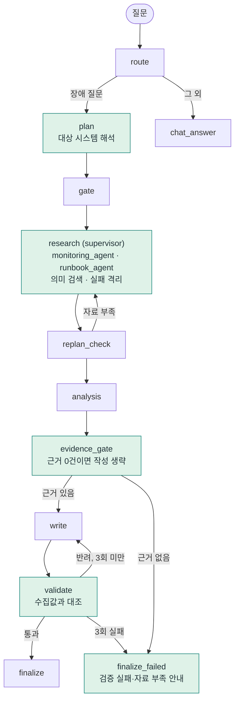
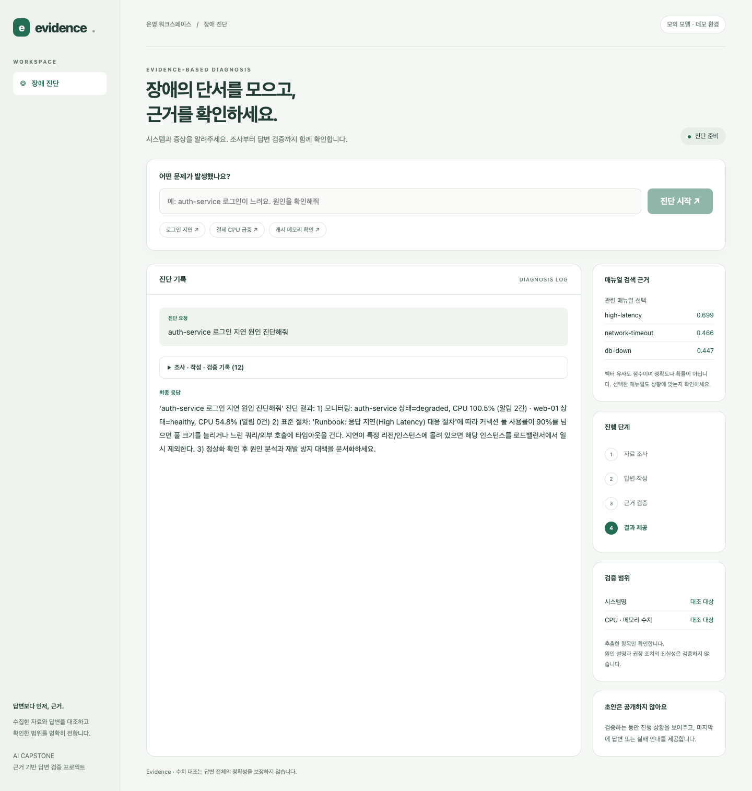
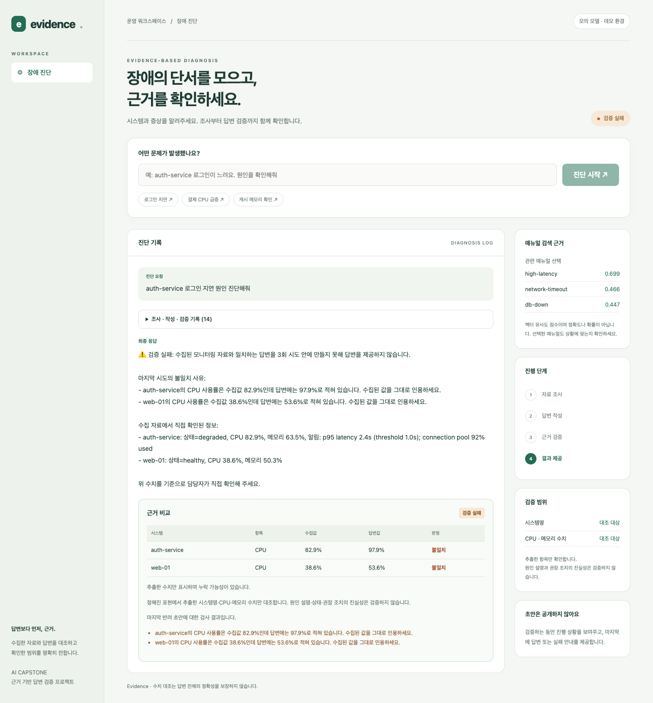
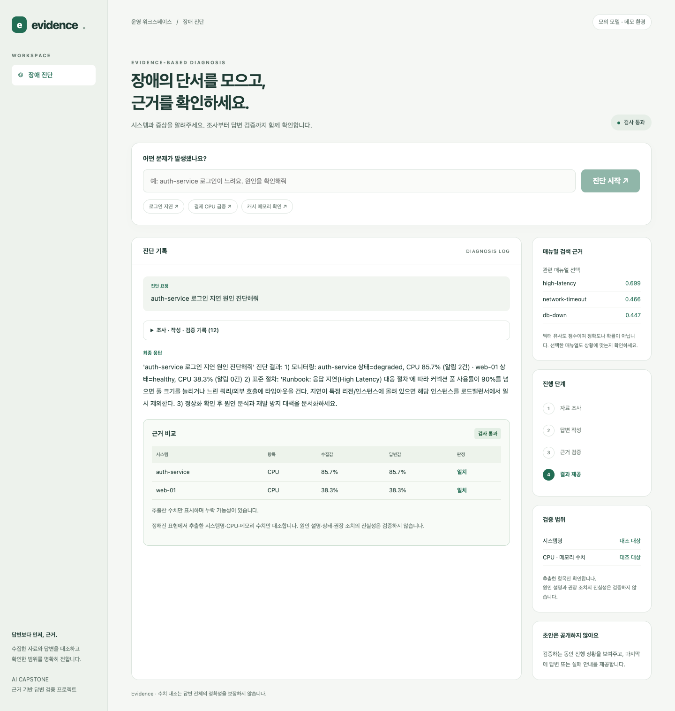

# 결과보고서: 운영 장애 진단 에이전트의 근거 기반 검증·검색·조사 안정성 개선

AI Capstone 개인과제 / 김하연 / 2026-10-21

과제 유형은 Base AI Agent 개선이다. 단계별 평가 과정과 원본 수치는 [`doc/상세평가기록.md`](../doc/상세평가기록.md), 설계 결정은 [`doc/ADR.md`](../doc/ADR.md)에 있다.

## 1. 개요

제공받은 에이전트는 장애 질문을 받으면 모니터링 자료와 대응 매뉴얼을 수집해 답변을 쓴다. 이 에이전트의 답변 검증, 매뉴얼 선택, 조사 실패 처리, 대상 시스템 처리를 개선했다. 답변이 수집한 자료와 맞는지 대조하고, 틀리면 사유를 알려 다시 쓰게 하며, 끝내 맞추지 못하면 강제로 통과시키지 않고 실패를 안내한다. 답변에 담긴 원인 설명이 사실인지는 판정하지 않는다(범위 밖).

| 항목 | 결과 |
|---|---|
| 틀린 답변 차단 (동일 17개 입력) | 2/9 → 9/9, 정상 통과 8/8 유지 |
| 매뉴얼 선택 기대 일치 (14개) | 6/14 → 12/14 |
| 근거 없는 질문의 응답 시간 | 36.6초 → 1.2~2.7초 (작성 모델 호출 1회 → 0회) |

수치는 모두 직접 만든 평가 데이터로 얻었다. 한계는 6절에 적었다.

## 2. 문제 정의

제공받은 에이전트에서 다음 문제를 확인했다.

1. 답변 검증이 형식(30자 이상, `1)` 포함)만 확인해서 수집 자료와 다른 수치도 통과했고, 세 번 불합격하면 강제로 합격시켰다. 반려 피드백도 "짧다"로 고정이었다.
2. 매뉴얼을 키워드 규칙으로 골랐다. 키워드가 없는 표현이면 `db-down`을 기본값으로 썼다(14개 문장 중 6개만 기대와 일치).
3. 병렬 조사 중 하나가 예외를 내면 성공한 자료까지 버렸다.
4. 목록에 없는 시스템(예: billing-service)을 물으면 실모델 계획 정규화가 `auth-service`로 바꿔 조사하고 그 사실을 알리지 않았다.
5. 모니터링 근거가 하나도 없어도 비싼 작성 모델을 호출했다.

## 3. 개선 내용

수집한 자료와 답변을 대조하는 흐름으로 바꿨다. 색을 넣은 노드가 개선한 부분이다.



### 3.1 답변 검증 (`agent/verifier.py`)

답변의 시스템명과 CPU·메모리 사용률을 수집값과 비교한다. 정수 반올림을 고려해 0.5%p 이하 차이는 허용한다. 불일치하면 어디가 다른지 문장으로 작성 단계에 돌려준다.

```text
auth-service의 CPU 사용률은 수집값 81.7%인데 답변에는 96.7%로 적혀 있습니다. 수집된 값을 그대로 인용하세요.
```

재작성은 최대 3회이며, 계속 일치하지 않으면 초안을 버리고 실패 사유와 수집값만 안내한다. 모니터링 자료가 없으면 재작성하지 않고 "검증 불가"로 종료한다. 표현 범위는 두 단계로 넓혔다. 동의어(프로세서, 중앙처리장치), 숫자가 먼저 오는 문장, 마크다운 표, '각각' 구문, 영어 서술을 읽고, 임계치와 조건문("CPU 90% 이상 지속 시")과 부정된 수치("85%가 아니라")는 측정값으로 보지 않는다. 시스템명은 수치를 인용할 때만 요구하고, 조회하지 못했다고 밝히는 서술은 허용한다.

### 3.2 매뉴얼 의미 검색 (`agent/retrieval.py`)

로컬 임베딩 모델(`qwen3-embedding:0.6b`)로 매뉴얼 6개와의 코사인 유사도를 구하고, MCP 도구 `search_incident_runbooks`로 제공한다. 최고 점수가 0.45 미만이거나 1·2위 차이가 0.025 미만이면 고르지 않고 "미확정"으로 둔다. 선택한 매뉴얼 본문은 작성 모델에 전달한다(검색 증강 생성 흐름). 두 기준값은 설계값이며 최적임을 입증하지 않았다.

### 3.3 조사 서브에이전트와 실패 격리 (`agent/subagents.py`)

research 노드가 한 함수로 처리하던 조사를 `monitoring_agent`(도구 호출, 재시도, 15초 제한, 조회 불가 상태 걸러내기)와 `runbook_agent`(의미 검색 60초 제한 또는 기존 조회) 두 서브그래프로 나눴다. research 노드는 작업 분배와 병렬 실행, 결과 취합만 맡는다. 작업별로 예외를 가둬 성공한 자료를 유지하고, 실패한 대상은 답변에 한계로 표시한다.

### 3.4 대상 시스템 해석 (`agent/targets.py`)

질문에서 조사할 시스템을 코드가 해석하고 폴백을 숨기지 않는다. 대소문자·밑줄 표기 차이는 무시하고(`Payments_Service`), 숫자 인스턴스 표기는 소속 시스템으로 본다(`payments-service-3`). 목록에 없는 시스템은 다른 시스템으로 바꾸지 않고 조사 실패로 안내하며, 시스템명이 아예 없을 때만 기본값(`auth-service`)을 쓰고 그 사실을 답변 첫머리에 알린다.

### 3.5 근거 점검 (`agent/nodes/evidence_gate.py`)

모니터링 근거가 0건이면 작성 모델을 호출하지 않고 "자료 부족 · 검증 불가"로 바로 종료한다. 어차피 검증할 수 없는 답변을 쓰는 데 드는 호출을 줄이는 비용 최적화다.

### 3.6 구조와 화면

한 파일(425줄)에 있던 그래프 노드를 `state.py`와 역할별 모듈 6개로 나눴다(동작 변경 없음). 화면에는 진행 단계, 수치 비교표, 매뉴얼 검색 후보와 점수, 검증 범위를 표시하고, 반려될 초안은 서버와 화면에서 차단한다. 두 항목의 코드는 수업 제공 파일과 섞여 있어 공개 저장소에 포함하지 않았다.

## 4. 사용한 기술 요소

| 기술 | 제공받은 것 | 직접 변경·활용 |
|---|---|---|
| LangGraph | route → plan → gate → research → replan_check → analysis → write → validate → finalize | 검증 실패 분기(`finalize_failed`), 근거 점검 노드 추가, research를 서브그래프로 분리 |
| Multi-Agent | 한 그래프 안의 역할별 노드(supervisor 구조) | monitoring·runbook 서브에이전트. LLM이 판단하지 않고 도구를 호출하는 작업자이며 서로 협상하지 않는 얕은 형태 |
| MCP | 모니터링 도구, 매뉴얼 자료, 표준 절차 프롬프트 | 검색 도구 `search_incident_runbooks` 추가 |
| RAG | 매뉴얼 조회 | 질문과 수집 알림으로 의미 검색, 선택한 매뉴얼 본문을 작성 모델에 제공 (외부 벡터 DB·청크 분할 없음) |
| 의존성 주입 | `SupervisorDeps`를 `functools.partial`로 각 노드에 주입 | 서브에이전트도 같은 방식으로 주입, `validator_mode`·`retrieval_mode`를 deps로 바꿔 개선 전후를 비교. 테스트에서는 deps를 가짜 객체로 교체 |
| LangSmith | `@traceable` 추적 코드 | 추적을 켜고 1회 실행해 서브에이전트·근거 점검·검증 노드가 같은 트리에 기록되는 것을 확인(59개 run, 원본 `eval/langsmith-trace-20261021.txt`). 데이터셋·평가자를 쓴 비교 평가는 하지 않음 |
| 모듈화 | `agent/` 패키지 | 노드 모듈 분리, `targets`·`subagents`·`verifier`·`retrieval` 모듈 신설 |
| 테스트 | 없음에 가까움 | 테스트 6종과 평가·측정 스크립트(`eval/`), 실행기 `bash eval/run_tests.sh` |
| FastAPI · SSE · SQLite · 모델 분리 | 서버, 진행 스트리밍, 세션 저장, fast/quality 모델 | 초안 토큰 차단, 근거가 없으면 작성 모델 호출 생략. 모델 분리는 효과를 측정만 함 |

## 5. 구현 화면과 개선 전후 실측

### 5.1 개선 전후 화면

같은 질문에서 작성 모델이 CPU 수치를 15%p 높게 쓰도록 모의하고, 검증 설정만 바꿔 비교했다. 모의 모델로 재현한 결과이며 실모델 결과가 아니다.

개선 전(형식만 검사): 수집값과 다른 CPU 100.5%, 54.8%가 근거 표시 없이 그대로 최종 응답이 됐다.



개선 후(수집값과 대조): 3회 재작성 후에도 일치하지 않아 답변을 제공하지 않고, 불일치 사유와 수집된 실제 값, 근거 비교표를 보여준다.



정상 진단 화면에는 근거 비교표, 매뉴얼 검색 후보와 점수, 검증 범위가 함께 표시된다. 실제 서버와 MCP, 로컬 임베딩 모델에 모의 작성 모델을 연결한 화면이다.



### 5.2 실측 요약

| 항목 | 개선 전 → 후 | 비고 |
|---|---|---|
| 틀린 답변 차단 (동일 17개 입력) | 2/9 → 9/9 | 정상 통과 8/8 유지. 입력은 같고 검증기만 교체 |
| 검증 규칙 확장 (표적 28개) | 오류 차단 6/14 → 14/14, 정상 통과 7/14 → 14/14 | 약점을 겨냥해 만든 사례라 낙관적임 |
| 설계 때 보지 못한 변형 (6개) | 오류 차단 4/5 → 5/5 | 표본이 작아 일반화의 근거로는 약함 |
| 개선 직후 점검에서 찾은 부작용 탐침 (8개) | 정상 1/4 → 4/4, 오류 3/4 → 4/4 | 부작용을 고친 뒤의 회귀 방지용 |
| 매뉴얼 선택 (14개) | 기대 일치 6/14 → 12/14 | 장애 질문만 6/12 → 10/12, 무관 질문 미선택 0/2 → 2/2 |
| 근거 없는 질문의 응답 시간 | 36.6초 → 1.2~2.7초 | 작성 호출 1 → 0회, 추정 비용 $0.005765 → $0.000085, 단일 질문 3회 |
| Ollama 실모델 (4문항 × 1회) | 작성 시도 1.0 → 1.0회, 시간 42.6초 → 43.3초 | 개선 효과를 주장하지 않음 |

### 5.3 평가 방법

규칙을 고치기 전에 평가 사례를 먼저 작성했고, 개선 직전 검증기를 `eval/baseline/verifier_before_v2.py`로 보관해 같은 사례로 비교했다. 17개 입력 비교와 매뉴얼 검색 14개 사례는 개선 전 구현과 개선 후 구현에 같은 입력을 직접 넣어 얻었다. 검색 사례 14개는 장애 12개와 무관한 질문 2개다.

### 5.4 실모델(Ollama) 결과

작성은 `qwen3:8b`, 분류·계획은 `qwen2.5:0.5b`로 질문 6종을 개선 전·후 설정으로 한 번씩 실행했다. 개선 전은 `legacy` 검증과 `legacy` 검색, 개선 후는 근거 대조 검증과 의미 검색이다.

- 앞 4개 질문은 두 설정 모두 한 번에 통과했고 평균 시간은 42.6초와 43.3초였다. 마지막 수정 직전 코드로 한 번 더 실행했을 때는 평균이 96.3초(268초 이상치 1건 포함)와 30.8초였으므로, 실행 간 변동이 커서 시간 개선은 주장하지 않는다.
- 개선 직후 중간 버전에서는 평균 2.0회였던 재작성이 최종 코드에서 1.0회가 됐지만, 개선 전(`legacy`)도 처음부터 1.0회였다. 줄어든 것은 시스템명 요구를 수치를 인용할 때로 완화한 영향이며 정확도 향상이 아니다.
- 목록에 없는 `billing-service` 질문에서 개선 전 검증은 모니터링 근거가 없는데도 일반적인 점검 조치를 담은 답변을 통과시켰다. 개선 후에는 "모니터링 대상에 없어 검증할 수 없다"고 안내했다. 두 번의 실행에서 일관되게 확인된 차이는 이것이다.

### 5.5 측정만 한 것

제공받은 구조를 측정한 결과이며 직접 구현한 기능이 아니다.

| 항목 | 결과 | 비고 |
|---|---|---|
| 병렬 vs 직렬 조사 (모니터링 3개) | 0.36~0.37초 vs 1.07~1.08초 (약 3배) | 원본 코드의 태스크당 0.35초 고정 지연(시뮬레이션)이 포함됨 |
| fast/quality 모델 분리의 비용 | 분리 $0.0027 vs 전부 quality $0.0067 (약 59% 절감 추정) | 토큰을 글자 수/4로 추정하고 단가를 가정함 |
| 서브에이전트 분리의 오버헤드 | 그래프 전체 0.73초 → 0.74초 | 성능 이득은 없음 |

## 6. 한계와 트레이드오프

### 6.1 개선이 새로 만든 약점

- 임베딩 검색은 정확도를 얻는 대신 비용을 낸다. 임베딩 모델만 올린 상태에서 콜드 첫 검색 약 1.1초, 인덱스 재구축 약 0.28초, 웜 검색 약 29ms(기존 키워드 분류는 약 2µs)이고 모델은 639MB이며 Ollama에 의존한다. 실서버 첫 요청에서 작성 모델과 메모리를 나눠 쓸 때는 9.64초가 관찰됐다. 인덱스는 메모리 캐시라 재시작이나 매뉴얼 변경 시 다시 만든다.
- 재작성과 재조사 루프는 무한 반복을 막기 위해 한도를 두었다(검증 재작성 3회, 재조사 1회). 한도에 닿으면 강제 합격이 아니라 실패를 안내한다.
- 시스템명 요구를 완화한 대가로, 수치가 없는 답변은 어느 시스템 이야기인지 확인하지 않고 통과한다.
- 반려될 초안을 노출하지 않기 위해 토큰 단위 스트리밍을 포기했다. 사용자는 최종 답변까지 기다린다.
- 서브에이전트 분리와 모듈화는 구조를 명확히 했을 뿐 성능 이득은 없고 파일 수가 늘었다.

### 6.2 개선 과정에서 발견해 수정한 문제

- 임계치와 조건문을 제외하는 규칙이 "CPU가 99% 이상 지속"처럼 틀린 측정값을 통과시켰다. 평가를 다시 돌려 찾아 조건문 어미만 제외하도록 좁혔고, 이 수정이 실제 런북 문장("CPU가 90%를 넘고 지속되면")을 놓치는 회귀를 만들어 한 번 더 고쳤다.
- 외부 검토에서 조회하지 못한 시스템의 수치가 다른 시스템과 같으면 통과하는 버그와, `oauth-service`가 `auth-service`로 부분 인식되는 버그가 발견되어 수정했다.
- 비용 절감 추정이 47%에서 59%로 달라진 것은 검증 오탐으로 있던 불필요한 재작성이 사라졌기 때문이었다. 이 추정치는 재작성 횟수에 민감하다.

### 6.3 남은 한계

- 검증은 시스템명과 CPU·메모리 수치의 일치만 본다. 규칙 기반이라 새로운 표현은 놓칠 수 있다.
- 수치는 직전에 나온 시스템명에 연결한다. 조회하지 못한 시스템을 설명한 문장 뒤에 다른 시스템의 수치가 오면 정상적인 서술도 반려될 수 있고, `customer-service`나 `top-10` 같은 일반 표현을 시스템으로 오인한다.
- 평가는 소규모 자체 데이터이며 사례를 만든 사람과 구현한 사람이 같아 낙관적일 수 있다. 실모델은 질문당 한 번만 실행했다. OpenAI 실모델과 LangSmith 기반 비교 평가는 하지 않았다.
- 서브에이전트는 PDF 예시의 3분할(로그·메트릭·런북) 중 로그 분석을 하지 않았고, LLM 판단 없이 도구를 호출하는 구조다.

## 7. 추가 개선 사항

- 수치를 문장에서 추출하지 않고 모델이 구조화된 형태로 출력하게 해 검증 규칙의 표현 의존을 줄인다.
- 독립적으로 만든 평가셋으로 검증과 검색의 정확도를 다시 측정한다.
- 시스템명 요구 완화가 정확도에 미치는 영향을 별도로 검증한다.
- 대상 시스템이 불분명하면 기본값으로 진행하지 않고 사용자에게 되묻는다.
- 로그·메트릭 분석 서브에이전트를 추가하고 LangSmith 데이터셋 기반 평가를 도입한다.
- 매뉴얼이 늘어나면 인덱스를 영속화하고 청크 분할과 외부 벡터 저장소를 검토한다.

## 8. 재현과 근거 자료

이 저장소만으로 재현되는 것은 `python3 eval/eval_verifier_v2.py`(검증기 개선 전후 42개 사례)이다. 나머지 평가는 수업 제공 기본 프로젝트가 필요하며, 저장된 결과 파일로 확인한다. 자세한 방법은 [README](../README.md)에 있다.

| 근거 | 파일 |
|---|---|
| 검증기 개선 전후 비교 기준선 | `eval/baseline/verifier_before_v2.py`, `eval/eval_verifier_v2.py` |
| 17개 입력 비교, 그래프 전체 실행 | `eval/results.md` |
| 매뉴얼 검색 14개 | `eval/search-evaluation-20261021.json` |
| 대상 시스템 해석 전후 | `eval/targets-baseline-20261021.json`, `eval/targets-after-20261021.json` |
| 실모델 실행 원본 | `eval/ollama-live-20261021.json`, `eval/ollama-live-20261021-r2.json` |
| 근거 없는 질문의 조기 종료 | `eval/ollama-live-evidence-gate-20261021.json` |
| 병렬·비용·임베딩 측정 | `eval/bonus-measure-20261021.md`, `eval/embedding-cost-20261021.md` |
| LangSmith 추적 구조 | `eval/langsmith-trace-20261021.txt` |
| 단계별 상세 평가 기록 | `doc/상세평가기록.md` |
